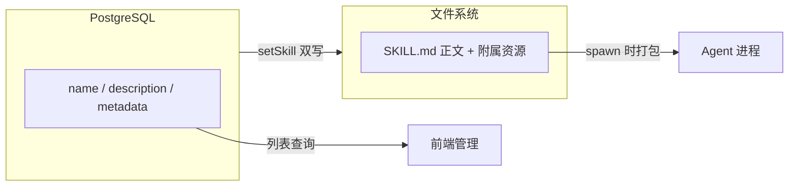

# Skills 配置

> 涉及模块：Skill 配置服务、Skill 文件系统、LaunchSpecBuilder

## 概述

Skill 是 Agent 可挂载的技能模块——每个 Skill 包含一个 `SKILL.md` 文件，定义 Agent 的特定能力（如代码审查、文档生成）。Skill 采用 DB + 文件系统双存储架构。

## 名称契约

- 平台采用 ASCII kebab-case：1–64 个 `a-z`、`0-9` 或 `-`，禁止首尾连字符及连续连字符；单个字母或纯数字也合法。名称不自动去空白、转小写或转换成拼音。
- 该限制采用 [Anthropic Skill 编写指南的字符范围](https://platform.claude.com/docs/en/agents-and-tools/agent-skills/best-practices#naming-conventions)，是 [Agent Skills 规范](https://agentskills.io/specification#name-field)当前 Unicode 字母数字范围的 ASCII 子集；不是所有 Skill 实现都禁止中文。
- 创建、目录导入、覆盖导入和系统创建共用名称校验，整批导入在任何资源行或文件写入前检查全部名称。前端表单复用同一规则。
- 名称对应技能源目录和生成的 `SKILL.md` 中的 `name`；更新接口仅修改内容、描述及元数据，不支持改名。不迁移或清理存量名称。

## 存储架构

Skill 采用 DB + 文件系统双存储架构：

**核心契约：双写一致性**。创建或更新 Skill 时，必须**同时写入 DB 和文件系统**。只写 DB 会导致 Skill 内容不下发给 Agent。必须通过 `setSkill`/`importSkillDirectories` 创建，禁止直接调 `upsertSkill`。

## 与 AgentConfig 的关系

AgentConfig 通过 `agentConfigSkill` 多对多表绑定 Skill。更新 AgentConfig 时全量覆盖——新集合替换旧集合，不留残留绑定。

spawn 时 LaunchSpecBuilder 将绑定关系转换为 `SkillConfig[]`：从文件系统源目录打包为 ZIP 归档 → 生成 HMAC 签名的一次性下载 URL → 注入到 `AgentLaunchSpec`。

详见 [Agent Config 资源引用](./04-agent-config.md)。

## 跨组织共享

控制台管理、探测与下载通过数据库 ID 定位并由 Facade 校验访问权限；名称不承担管理接口的资源键职责。运行时的领域引用保持既有约定。完整 REST 路径见 [配置系统](./06-config.md#控制台资源接口)。
