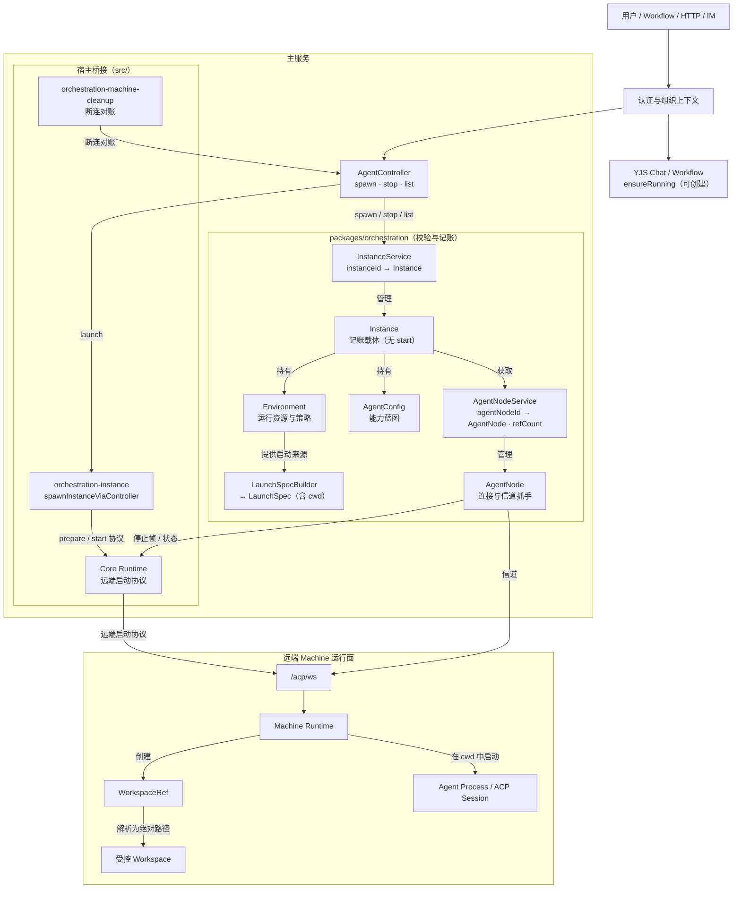
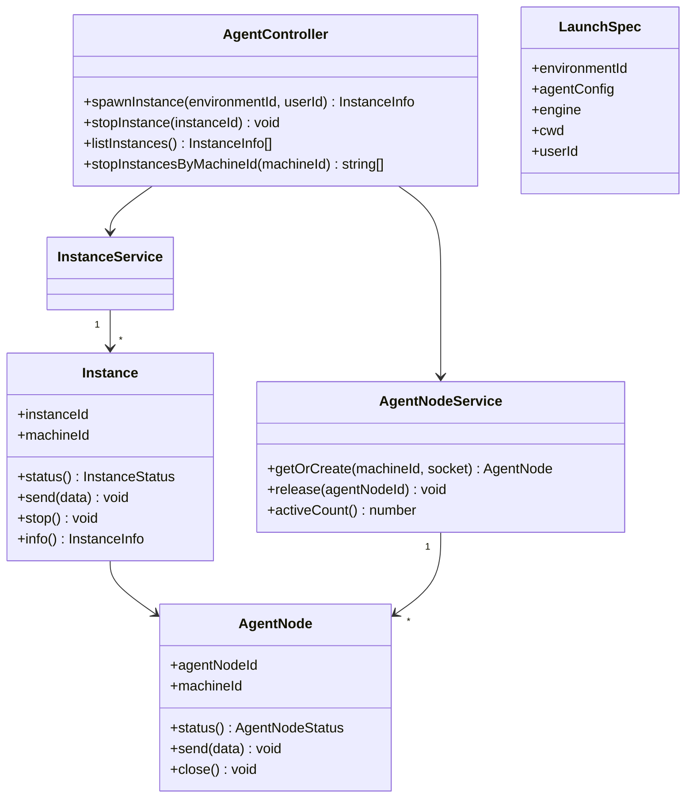
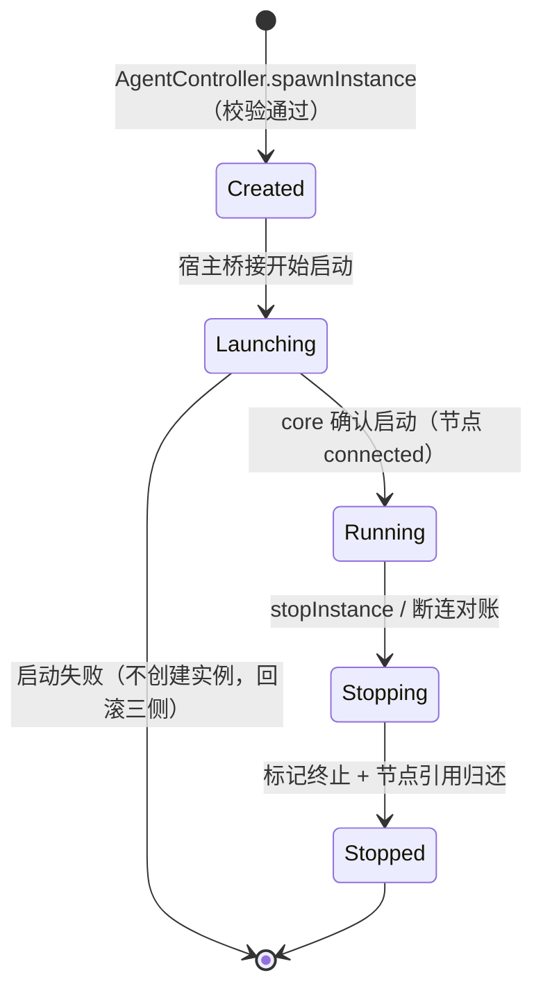
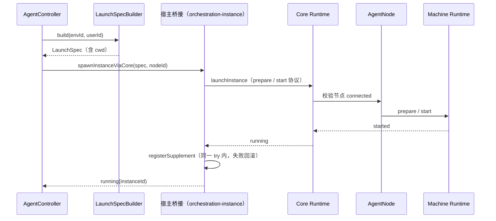
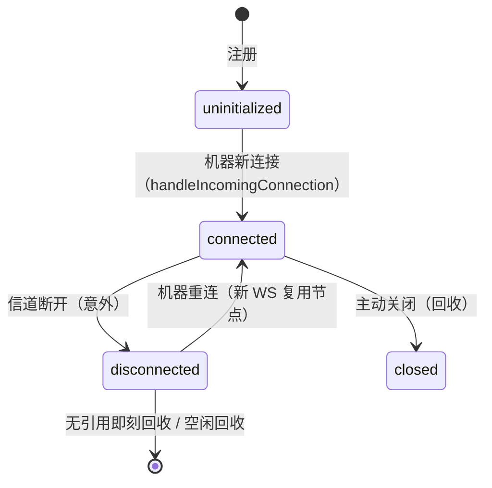

# AgentController 编排域架构（实现基线）

> 状态：实现基线（2026-08-05 修订，对齐 `refactor/agent-controller` 分支，验证测试 215 个全绿；2026-09-23 按现网实现核对 §8.4，登记 `/web/environments/:id/enter` 的终结式本地 catch 为例外（§8.5），测试基线沿用 2026-08-05 记录、未重跑）
> 范围：编排域独立包 `packages/orchestration`（AgentController、AgentNodeService、AgentNode、Instance、LaunchSpecBuilder）与宿主桥接（`packages/agent-runtime/src/services/orchestration-instance.ts`、`orchestration-bootstrap.ts`、`orchestration-machine-cleanup.ts`、`packages/agent-runtime/src/transport/agent-node-bridge.ts`、`local-node-service.ts`、`packages/agent-runtime/src/server/transport/relay/external-relay.ts`）的创建、连接和生命周期。
> 定位：本文档只定义 Agent 实例的控制与运行边界。YJS / ACP 到 YJS 的状态聚合与 Chat 域见 `docs/arch/19-yjs-chat-streaming.md`；文件操作信道（file-ws，与 acp-ws 平行的机器级信道）见 `docs/arch/12-files.md`。
> 消费者审计与已落地实现中仍有效的断连终态、用户配额约束已体现在本文 §5、§2.2，不再单独成文。
> 约定：本文档从"目标设计基线"修订为"已验证实现基线"，描述与代码一致的真实架构；代码演进偏离时，先更新本文档再改代码。关键实现文件以相对路径引用（行号不维护，以语义为准）。

## 1. 总体架构

编排域采用**双层模型**：编排域（`packages/orchestration`）只负责校验、记账与停止帧，不触碰远端启动协议；真正的远端启动由宿主 core runtime（remote transport）完成。



- **编排域不发起远端启动协议**：`prepare` / `start` 由 core runtime 经 remote transport 下发（`acp-ws-handler.ts` 路由 prepare_result / start_result）；编排域 AgentNode 只管 WS 生命周期与停止帧。
- **本地执行回退**：无 machineId 配置时回退链为 `config.machineId → RCS_DEFAULT_MACHINE_ID → local-default`（`local-node-service.ts` 占位节点），旧本地执行语义保留。
- **YJS Chat / Workflow 路径经 `ensureRunning` 可创建实例**（见 §7），不是"只读查询"。

## 2. 领域模型

### 2.1 核心对象



| 对象 | 责任 | 不负责 |
|---|---|---|
| `AgentController` | 鉴权后处理实例 spawn / stop / list；维护 `instanceId → Instance` 活跃表；并发二次检查与回滚 | 不解析 ACP、不维护聊天状态、不发起远端 prepare/start 协议 |
| `Instance` | **记账载体**：懒查询状态、停止帧、终止标记；N 个 Instance 可共享一个 AgentNode | 不管理自身启动（启动在宿主桥接 + core）、不关闭共享节点连接 |
| `AgentNode` | 唯一的远端连接拥有者：持有 WS、暴露 send/close；`connected` 是可用性门禁 | 不解析 ACP 消息、不承载业务协议 |
| `AgentNodeService` | `agentNodeId → AgentNode` 注册、复用、引用计数、空闲回收 | 不管理 Instance |
| `LaunchSpecBuilder` | 从 Environment + AgentConfig + Engine 聚合不可变 LaunchSpec（含 cwd） | 不读取环境变量（workspaceRoot 宿主注入） |

**状态推导**：`Instance.status()` 是懒查询（`instance.ts`），由 `#terminated` 标记 + AgentNode 状态映射得出，无显式状态机：

| AgentNode 状态 | Instance 可见状态 |
|---|---|
| uninitialized / connecting | `starting` |
| connected | `running` |
| disconnected | `error`（意外断连，可用性不可确认） |
| closing / closed / destroyed | `stopped` |

### 2.2 身份与授权

| 标识 | 归属 | 用途 |
|---|---|---|
| `environmentId` | Environment | 用户运行资源与策略的授权范围 |
| `agentConfigId` | AgentConfig / Instance | 选择能力蓝图并固化到 Instance |
| `instanceId` | InstanceService | 主服务侧运行实例标识 |
| `agentNodeId` | AgentNodeService | 主服务侧 Agent Node 标识 |
| `machineId` | AgentNode | 定位对接的 Machine；由 AgentConfig.machineId → `RCS_DEFAULT_MACHINE_ID` → `local-default` 回退链解析 |

所有 Controller 命令先根据认证得到 `organizationId`、`userId` 与角色，再验证 Environment 归属及关联 AgentConfig 的可见性。`instanceId` 和 `agentNodeId` 仅在已授权的 Environment 范围内解析；浏览器不可指定远端物理路径、Node 内部连接 ID 或 ACP session ID。

**userId 传递规则**（C-P2.5 决策）：实例创建必须携带**真实触发用户**的 userId；workflow 路径由 route 透传 `authCtx.userId`（无触发者的 scheduled 回退 `"system"`），sub-workflow 沿用父级 `callerUserId`。userId 决定用户级并发配额桶归属，禁止用字面量 `"system"` 代替真实用户（否则跨租户共享同一配额桶，破坏多租户隔离）。

## 3. 实例生命周期



- **spawn 失败不创建实例**：`spawnInstanceViaController` 的 try 块覆盖 build → launch → registerSupplement 全链路；任一步失败走 `stopInstanceViaController` 回滚三侧（controller 活跃表 + core 进程 + registry supplement），不留下可被查询的半初始化实例（A/D-P1.3 修复）。
- **`stop()` 语义**（`instance.ts`）：节点 `connected` 时发送带 `instance_id` 的停止帧（snake_case，与机器端协议对齐），随后置位 `#terminated`；停止帧发送失败不阻断停止流程（避免产生幽灵活跃表残留）。**不关闭共享的 AgentNode 连接**——同节点其他实例仍在使用；节点引用归还由 `AgentController.stopInstance` 负责。
- **`stopInstance` 幂等**：三侧状态（supplement / 活跃表 / core 快照）任一存在即执行幂等停止，全无墓碑时返回 "Already stopped"（web DELETE 连续两次均 200，A/E-P2.1）。
- 回收策略可请求 `stop()`，但不能绕过 Instance 生命周期直接操作远端进程——**断连对账除外**（机器不可达时无法走正常停止链，见 §6）。

### 3.1 持久实例生命周期仲裁

`AgentInstanceRuntimeCoordinator` 是持久实例生命周期的唯一仲裁者；Controller、Core 与 supplement 是执行与查询投影。

1. `instanceUid` 是持久身份；`runtimeGeneration + serverEpoch` 标识一次真实运行实体。`operationId` 只标识当前操作所有权。stop/delete 推进操作身份，不改变尚未停止实体的运行身份，因此停止期间的机器断连仍能关联原实体。
2. 高优先级 stop/delete 取消旧启动后，等待启动及其按原运行代次执行的补偿结束，再确认当前实体停止。启动桥接在 controller、LaunchSpec、Core 启动与 supplement 注册边界检查取消，本地与远程启动均携带运行身份。补偿失败保留 `unknown` 与原始错误，不返回已停止。
3. `unknown` 拒绝自动 ensure，允许显式 start/stop/restart/delete 重新确认；start 必须先确认旧运行实体已停止。runtime 删除阶段失败释放本次删除门禁；DB 删除失败按 `operationId` 恢复门禁，旧操作不能解除另一轮删除。
4. 本地死亡经运行身份回收，idle 与 Workflow 自动收尾经公共 `reclaimInstance(id, organizationId, runtimeGeneration)` 进入 `reclaimRuntime`；回收不建立手动停止意图，后续 ensure 可启动新代。手动 stop 建立的禁止自动启动意图在主动进入（start）或显式 restart 成功后解除；后台重连、API 和 Workflow 的 ensure 不解除。running 快捷路径同时核对执行投影，投影已确认不存在时重新启动。start 复用已就绪或正在正常启动的实体，restart 则停止原实体后启动新代。
5. 机器断连事件按实际运行代次标记 `unknown`，clean-slate 只确认对应机器旧 runtime 已全部终止。在途操作持有槽位时延后复位，操作释放后提交 `stopped`。确认终止同时释放该实例尚未结算的执行配额。

## 4. 双层启动模型与 LaunchSpec

### 4.1 启动时序



- 并发二次检查：controller 在 spawn 前检查活跃表与配额（`agent-concurrency.ts` 同步段登记预留），启动失败或超发时回滚活跃表（A-P2.1 修复）。
- **nodeId 单一来源**：core nodeId 直接取 `instance.machineId` 快照，禁止二次读 env 推导（消除双构建 TOCTOU，A-P2.2 修复）。

### 4.2 LaunchSpec 内容与边界

`LaunchSpec` 是启动 Agent 实例所需的全部静态信息聚合视图，构建后不可变：

| 内容 | 说明 |
|---|---|
| Agent 定义 | 扁平聚合的配置（skills / knowledgeBases / mcpServers 已内嵌） |
| 引擎信息 | 按 `agentConfig.engineId` 解析 |
| **cwd** | 主服务按 `{workspaceRoot}/{organizationId}/{userId}/{environmentId}` 确定性计算（workspace 路径不变量） |
| 执行范围 | `environmentId`、`userId` |

**cwd 归属（D1 修订）**：cwd 由主服务计算并下发（`launch-spec-builder.ts`），机器端再将其解析为受控 Workspace 的绝对路径。cwd 是确定性派生值而非"机器本机路径"，因此不违反可信执行范围约束；但文档旧版"LaunchSpec 不包含 cwd、主服务不能拼接路径"的表述已废弃。

**双份构建过渡态（D5 记录）**：编排域 LaunchSpec 只有上述扁平视图；运行时字段（密钥、skill 下载 token、MCP 详细配置）由宿主 `buildAgentLaunchSpecForCore` 从 DB 重建后经 core 下发。当前存在"双份构建"，收敛计划见 PRD（Phase C）。

LaunchSpec 不包含 `agentNodeId`、Machine 本机绝对路径、`instanceId`、ACP session ID、聊天内容或 YJS 数据。敏感运行凭据仅经认证信道传递，禁止写入日志、前端响应或持久化记录。

### 4.3 Machine 运行面

Machine Runtime 收到启动载荷后创建内部 `WorkspaceRef`、将 cwd 解析为受控 Workspace 并在其中启动 Agent Process。主服务只传递可信执行范围与派生 cwd，不拼接 Machine 本机路径。

```text
可信执行范围 + 派生 cwd
→ Machine WorkspaceRef
→ 受控 Workspace（绝对路径）
→ Agent Process / ACP session
```

## 5. Agent Node 生命周期与信道



- **断连即终态（E-P2.2 方案 A）**：server 端**不做自动重连**——`disconnected` 不接受 connect 事件，节点进入等待机器重连的终态；恢复完全由远端 Machine 主动重连驱动（宿主 `handleIncomingConnection` 复用节点、attach 新 socket）。FSM 不再有 connecting 中间态与空转定时器。
- **引用计数与空闲回收**：`AgentNodeService` 维护 `#refCounts`（每 Instance 一次），引用归零且节点 `disconnected` 时触发空闲回收；**connected 节点不回收**——关闭 connected 节点会切断机器真实 WS（E-P1.1 教训：节点回收不得引发机器断连风暴）。
- `AgentNode` 是唯一的远端连接拥有者；Instance 只能调用 `send()`/`stop()`，不能自行创建、替换或关闭底层 WS。
- 一个 AgentNode 可为多个已授权 Instance 提供信道；停止帧必须携带目标 `instanceId`（snake_case），避免同节点运行串扰。
- **断连即失败（E-P2.1 教训）**：`WsAgentNodeSocket.send` 在 `readyState !== 1` 时抛 `AgentNodeUnavailableError`，禁止静默丢弃（静默丢包会让停止帧无回执、调用方误以为可达）。
- **文件信道联动（12-files.md 交叉引用）**：机器还有第二条平行信道 `/acp/file-ws`（文件操作）。**重连顺序是跨仓库契约**：机器侧先连 `/acp/ws` 完成 `registerMachine` + `registerRemoteNode`，再连 `/acp/file-ws`；file-ws register 对账 core runtime node，未注册 → close(4404) 退避重试（4404 与 YJS 4004"环境不存在=终态"语义区分，见 12-files.md §7.1）。服务端不承诺重连，恢复完全由机器驱动（同 E-P2.2）。file-ws 的生命周期、断连语义与能力降级见 `docs/arch/12-files.md` §5/§7。

## 6. 三侧状态对账（断连语义的根）

实例状态分布在三侧，**必须同生共死**：

| 状态侧 | 载体 | 清理入口 |
|---|---|---|
| controller 活跃表 | `AgentController`（`packages/orchestration`） | `stopInstance` / `stopInstancesByMachineId` |
| core 快照 | `CoreRuntime.listInstances()` | `runtime.deleteInstance` |
| registry supplement | `globalInstanceRegistry` | `unregister` / `reconcile` |

**E-P0.1 教训（幽灵实例）**：任何一侧的清理路径（断连、重连、sweep、rollback、幂等 DELETE）都必须收敛到统一入口——机器断连由 `cleanupOrchestrationInstancesForMachine`（`orchestration-machine-cleanup.ts`）→ `AgentController.stopInstancesByMachineId` 完成活跃表删除 + `releaseNode` 配对归还，并对每个被移除实例 fire-and-forget 触发实例级实时资源回收（`reclaimInstanceYjsDocs`，SP-C2：该路径不经过 `stopInstanceViaController`，不接则 `instanceSessions` 登记与保留的实时 Doc 永久泄漏）；机器重连分支同样先清理再接受新连接。缺失任何一侧都会产生幽灵实例：占用并发额度、web DELETE 永久 404、refCount 残留节点永久滞留。

**断连对账例外（D15 记录）**：机器不可达时无法走正常停止链，断连清理直接 `runtime.deleteInstance` + 删表 + 活跃表清理，绕过 `Instance.stop()` 的远端停止帧——这是唯一允许绕过正常生命周期路径的场景。

**已知缺口（R4）**：sweep 路径 `triggerMachineCleanupByMachineId`（entry 已消失时）未执行 `globalInstanceRegistry.reconcile`，与 `performMachineCleanup` 不一致，可能残留孤儿 supplement（量级小，属状态不一致，见 §11）。

**文件信道联动（对抗审查确认）**：`performMachineCleanup`（acp-ws 断连清理）**不触碰 file-ws 索引**——机器可能处于"acp-ws 断连（实例已清理、DB offline）但 file-ws 存活（文件操作继续可用）"的状态。该状态与"file 降级"（acp-ws 正常、file-ws 断连）组成 2×2 能力矩阵，由 `docs/arch/12-files.md` §1（能力矩阵）与 §7.4（degraded 事件）独立表达，**不扩展本文档机器状态机**（pending/online/offline 保持）。

## 7. 消费者边界

各入口先解析当前用户的持久 Instance，再经 Coordinator 确保 runtime。请求拥有独立消费租约、ACP session 与 turn；物理 relay 与进程由 runtime 持有。

| 场景 | 入口 | 实例与退出语义 |
|---|---|---|
| HTTP 程序化单轮 | `routes/api/openai-chat.ts` → `openAgentSession` | 复用用户的 `api/primary`；dispose 仅取消自身 turn、归还消费租约 |
| 前端交互式 Chat | `/acp/yjs/:agentId` → gateway → `ensureInstance` | 显式实例重新校验归属；缺省选择 `chat/default`，多标签页共享连接租约 |
| Workflow | `workflow/agent-chat-transport.ts` → `ensureInstanceRuntime` → `connectAgentRelay` | 复用 `workflow/primary`；各节点独立会话与 turn，取消信号覆盖 connect 和 execute |
| 外部实例连接 API | `api-instance.ts` → `resolveInstanceForOperation` → `ensureInstanceRuntime` | 复用当前用户的 `api/primary`，或校验显式实例归属；返回 relay 定位信息 |
| 停止 / 回收 / 断连 | Instance Service / idle monitor / 机器对账 | Coordinator 按 operation 与 runtime 身份确认状态，消费者不得按 UID 停止共享 runtime |

1. Core 首次建连共享在途操作，并为每次调用发放独立消费租约；租约 close 只移除该消费者监听器。runtime stop 统一关闭物理连接，包括仍在握手和迟到的连接。
2. Workflow 的 `instance-lease.ts` 在选定持久实例后、await ensure 前同步取得租约，保护连接准备与执行；`cleanupSpawnedInstances` 只消费首次创建者在 ensure 成功时登记的运行代次票据，且必须没有其他 run 租约与任何来源的活跃执行，才能自动回收。迟到或重复收尾不能改绑到新代，跳过后交由 idle 策略处理。单节点 dispose 不触发该实例策略。
3. 活跃执行准入与 relay 计数独立。HTTP、Workflow 和定时任务每次分别 acquire 执行额度；confirmed RPC 终态归还。取消通知、传输失败和 EOF 不证明 Agent 已停止，未知执行保留额度，直到明确 RPC 终态或 Coordinator 确认 runtime 停止。
4. 会话握手、终态分类、静默超时及取消契约见 [Agent 执行、relay 与取消](./agent-turn-lifecycle.md)。

## 8. 隔离、并发与失败

### 8.1 隔离

- Environment 是用户级运行资源边界；同一 AgentConfig 被不同用户使用时必须进入不同 Environment，并创建独立 Instance。
- Instance 只持有一个 Environment、一个 AgentConfig 和一个 AgentNode；不得在运行中切换任一对象。
- AgentNode 可被多 Instance 复用，但每个命令按 `instanceId + environmentId` 路由；Node 连接共享不代表工作区、进程或 ACP session 共享。
- Workspace 由远端 Machine 按可信执行范围创建；不同 `{organizationId, userId, environmentId}` 映射到隔离路径（§4.2 cwd 不变量）。

### 8.2 并发治理分层（A-P2.1 教训）

业务并发配额统一使用宿主 reservation 闸门；执行节点容量是独立维度，不得混用：

| 层级 | 机制 | 状态 |
|---|---|---|
| 用户级 / 平台级实例容量 | `agent-concurrency.ts` 的 `beginSpawnReservation`，pending 计入实例数 | `RCS_USER_AGENT_MAX_CONCURRENCY` / `RCS_AGENT_MAX_CONCURRENCY` |
| scheduled 执行并发 | `agent-execution-admission.ts` 每次执行独立准入，实例复用仍分别计数 | `RCS_SCHEDULED_AGENT_MAX_CONCURRENCY`；未确认执行终止时保留额度 |
| Machine 容量 | `machine.maxSessions` 数据模型 | 仅保留容量元数据，当前未执行准入；未来实现时必须使用 Machine 专属 reservation / 错误码 |

Environment 不再持有 `maxSessions` / `maxConcurrency` 配额。`AgentController` 只维护实例生命周期，禁止按 Environment 对内存实例表重新计数限流；业务并发治理统一由宿主 reservation 管理，以避免重复闸门和 TOCTOU 语义分裂。

### 8.3 失败与补偿

| 失败点 | 行为 | 对外结果 |
|---|---|---|
| AgentNode 不在线 | `ensureNode` 只放行 `connected`，否则抛 `AgentNodeUnavailableError`（不创建实例） | 503（message 脱敏） |
| LaunchSpec 构建失败 | 抛 `LaunchSpecBuildError`，回滚 | 422 |
| spawn 任一步失败（含 registerSupplement） | `stopInstanceViaController` 回滚三侧（A/D-P1.3） | 脱敏错误，不泄漏 envId/machineId |
| relay 连接或会话握手失败 | 归还本消费者租约；未发 prompt 可释放执行准入，保留持久 runtime | 脱敏错误；握手超时或缺少 ID 明确失败 |
| turn RPC 错误 / 取消 / 传输失败 / EOF | 统一终态分类；仅明确正常 stopReason 成功。取消发送 session/cancel；未确认终止继续持有执行额度 | 有界失败，不补成功 end_turn |
| AgentNode 运行中断线 | 节点断连即终态；宿主断连对账清理实例（§6） | 返回当前状态，不伪造运行中 |
| stop 失败或超时 | Coordinator 保留 unknown；显式 start/stop/restart/delete 可重新确认 | 抛出停止未确认错误 |
| HTTP / workflow 静默超时 | 取消等待中的 next、请求取消自身 turn，归还消费资源；未确认停止的执行额度继续保留 | HTTP 504 / SSE error；workflow NODE_TIMEOUT |
| workflow relay 关闭 | 识别 `relay_closed` → exit_code=1，engine 按 NODE_FAILED 重试自愈 | 有界失败 |

### 8.4 错误映射与脱敏（A-P1.1 / D-P2.2 教训）

- 路由本地 catch 默认移除：需要本地映射时只做「重映射后 rethrow」，未识别的异常仍冒泡给全局 errorPlugin（`apps/server/src/plugins/error-handler.ts`）按稳定错误码映射，规则来源 `ORCHESTRATION_STATUS_MAP`（404 / 422 / 503）+ `ORCHESTRATION_MESSAGE_MAP` 通用模板（单一真相 `packages/agent-runtime/src/errors/orchestration-http.ts`，与 `/api/instances` 共用）。终结式本地 catch 是默认规则之外的偏离，必须登记且写清边界与移除条件（当前唯一一处见 §8.5）。
- 编排域错误 message 可能携带 envId / machineId，对外必须脱敏，完整诊断留服务端日志；SSE 流中途错误的 chunk 只输出固定通用文案。
- 新错误码漏登记时保守落 500 也不得泄漏内部标识。

### 8.5 错误映射例外：`POST /web/environments/:id/enter` 的终结式本地 catch

`packages/agent-runtime/src/routes/web/environments.ts` 的 enter 处理器在 `ensureInstance` 一段保留了**终结式**（穷举错误空间、不 rethrow）本地 catch。它不是漏改，而是本文档记录在案的唯一偏离：进程里确实存在一条错误路径，全局插件在结构上够不着。

**为什么全局插件接不住**

- 终结式 catch 不 rethrow，异常到不了 `onError`——errorPlugin 的 AppError / OrchestrationError / Sandbox 分支对本路由形同不存在。宿主 `error-handler.ts` 虽已覆盖同类领域错误，但它们只在异常冒泡时生效。
- 即便改为 rethrow，两条契约也不等价，不能直接收敛：
  - **信封不同**：本路由 `response` 用 `WebErrSchema`（`{success:false, error:{code,message}}`，`/web/*` 的共享信封，定义在 `packages/platform/platform-sdk/src/protocol/web-envelope.ts`），errorPlugin 兜底返回 `{error:{type,message}}`；同一路由不能混用两种信封，本路由已声明的 400 / 404 / 500 / 503 都属前者，换信封是破坏性契约变更。
  - **脱敏口径不同**：errorPlugin 的 `AppError` 分支直出 `error.message`，而资源包（`agent-config` 的 `throwInvalidConfig`）系统性把 `agentConfigId`、Skill / MCP 名拼进 message；本路由只输出安全模板文案，原始 message 与堆栈进服务端日志。

**这条 catch 的边界**

处理器前半段（归属校验 `getOwnedEnvironment`）的 catch 是**非终结式**的：只把 `NOT_FOUND` 重映射为 404，其余 rethrow 给 errorPlugin——同文件其它路由（GET / PUT / DELETE）与它是同一形态。终结式映射只覆盖后半段（`ensureInstance` 及运行快照），穷举结果如下（2026-09-23 核对）：

| 错误 | 对外结果 | 边界说明 |
|---|---|---|
| `code === "NOT_FOUND"` | 404 + `NOT_FOUND` | 实例/环境解析失败；在内层 catch 即返回 |
| `SandboxProviderNotConfiguredError` / `SandboxRuntimeNotReadyError` | 503 + `SERVICE_UNAVAILABLE` + 固定文案 | 错误对象携带 `providerKey` / `sbi_*` sandboxId，不得直出 |
| `OrchestrationError` | 按 `mapOrchestrationErrorToHttp`：`AGENT_NODE_UNAVAILABLE` / `MACHINE_OFFLINE` → 503，`LAUNCH_SPEC_BUILD_FAILED` → 422，未登记 code → 500 | 与 errorPlugin 共用同一映射函数，两处口径不得各自维护 |
| `AppError` | 错误自带的 `statusCode` / `code` | 文案只取 `APP_ERROR_MESSAGE` 模板（未登记 code 时：4xx 通用可读文案、5xx 内部故障文案），不直出 `error.message` |
| 其余未知异常 | 500 + `CONFIG_WRITE_ERROR` + 通用文案 | 既有对外契约，保持不动；原始 message 与堆栈进服务端日志（此前该路径静默吞错、连日志都没有） |

**新增同类分支时的约束**

1. 只允许对**已知错误类型**做更精确的提升（4xx / 503）；兜底恒为 500，不得把未知异常映射成 2xx 或任何「伪成功」——静默降级正是 §11 第 2 条记录的那类故障。
2. 新分支必须先写服务端日志再返回，对外 message 只能取安全模板，不得透传 `error.message`。
3. 分支按「具体在前、兜底最后」排列：`OrchestrationError` / `AppError` 这类基类判断一旦排到兜底之后即静默失效，错误被吞成 500。
4. 状态码集合变化必须同步 `response` 声明（如 AppError 分支引入的 400 已补入），保持 OpenAPI 契约与实现一致。

**移除条件**

errorPlugin 成为该路由错误出口的单一入口，且同时满足三条：①兜底能返回本路由的 `{success:false, error:{code,message}}` 信封（或前端消费方确认接受换信封）；②`AppError` 分支不再回传原始 `message`；③未知异常仍落既有的 500 + `CONFIG_WRITE_ERROR` 契约（或该契约经消费方确认废弃）。三条缺一不得删除本 catch。

## 9. 典型用户场景

### 场景 A：创建 Agent 实例

用户选择可见 AgentConfig 后，`spawnInstanceViaController` 在认证上下文中定位或创建 Environment；controller 检查配额（用户级 reservation）→ 构建 LaunchSpec（含 cwd）→ 宿主桥接经 core 启动远端 Agent Process（编排域不触碰 prepare/start 协议）→ 成功后才注册 supplement 并返回 `instanceId`。

### 场景 B：前端交互式 Chat

浏览器 WS 打开（`/acp/yjs/:agentId`，`packages/agent-runtime/src/routes/acp/index.ts` → `gateway.handleOpen`）→ `ensureRunning`（不存在则创建）→ Chat Doc / Session Doc 初始快照 → `relayReady`。实例复用语义与 YJS 不变量（rcsSessionId 确定性、cwd 注入、status 门禁、广播隔离）见 `19-yjs-chat-streaming.md`。

### 场景 C：Workflow 复用与清理

workflow run 解析用户的 `workflow/primary`，在 ensure 前绑定执行准入并取得实例使用租约，ensure 后确认 runtime，再取得 relay 消费租约与独立 ACP session。节点退出只处理自身 turn；run cleanup 携带首次创建时确认的运行代次，经公共自动回收入口释放执行资源；有其他使用者或运行换代则跳过。自动收尾不写用户停止意图，下一次仍可 ensure 同一个持久 ID；真正手动停止后须由用户主动进入或显式 restart 成功后才能恢复。超时或断连返回失败，执行终止未确认时保留执行额度。

### 场景 D：停止与回收

用户停止或策略回收先经 Coordinator 仲裁，再调用 `AgentController.stopInstance` → core 停止 → registry 移除 supplement → 实时资源回收。远端无法确认停止时保留 unknown，等待显式重试或机器 clean-slate 确认。手动停止与自动回收的恢复意图相互独立。默认空闲回收保护全部活跃执行；明确的 `activity-timeout` 原因仅可接管超过活动硬期限且全部执行均为已确认 scheduled 的实例，提交停止前复核运行代次、投影身份和活动时间。交互或等待启动的执行仍受保护，停止失败保留额度，确认实际停止后才释放。

### 场景 E：Agent Node 断线

`/acp/ws` 断开 → 节点进入 disconnected 终态（不再自动重连）→ 宿主断连对账（`cleanupOrchestrationInstancesForMachine`）清理该机器全部实例的三侧状态并归还节点引用 → 机器重连后 `handleIncomingConnection` 复用节点。断连期间对该节点的 spawn 返回 503；其他机器上的实例不受影响。

## 10. 设计决策摘要

1. **双层模型**：编排域校验/记账/停止帧，core runtime 负责远端启动协议；编排域不触碰 prepare/start。
2. **Instance 是记账载体**：懒查询状态（终止标记 + 节点状态推导），无 start()，启动在宿主桥接 + core。
3. **断连即终态**：server 端无自动重连，disconnected 只接受机器新连接的 open（E-P2.2 方案 A）。
4. **节点连接集中管理**：只有 AgentNodeService 管理节点注册/复用/引用计数/空闲回收；connected 节点不被空闲回收。
5. **三侧状态对账**：controller 活跃表 / core 快照 / registry supplement 同生共死，清理统一收敛（E-P0.1）。
6. **复用显式租约**：workflow 共享实例必须 acquire lease，cleanup 按 instanceId + 租约守卫（C-P1.1）。
7. **cwd 主服务派生**：cwd = `{workspaceRoot}/{organizationId}/{userId}/{environmentId}`，机器端解析落地。
8. **真实 userId 配额桶**：workflow 实例按触发用户计用户级配额，禁止字面 "system" 聚合（C-P2.5）。
9. **错误边界统一收敛 + 脱敏模板**：路由本地 catch 默认移除（仅重映射后 rethrow），全局 errorPlugin 按稳定 code 映射；唯一终结式例外见 §8.5。
10. **断连对账可绕过正常停止链**：机器不可达时直接删 core 快照 + 活跃表（唯一例外）。
11. **本地执行回退保留**：machineId 回退链 `config → RCS_DEFAULT_MACHINE_ID → local-default`。
12. **聊天链路独立**：YJS / Chat 域只经 `ensureRunning` 与 relay 消费实例，编排域本体不维护聊天状态。

## 11. 本次重构经验教训（bug 修复模式）

以下模式来自重构后消费者审计（审计报告内容已并入本文档 §7 消费者边界与 §12 技术债）与 P0-P2 修复批次，是编排域维护的**防复发清单**：

1. **三侧状态不一致 = 幽灵实例**（E-P0.1）：任何清理路径漏掉 controller 活跃表 / core 快照 / supplement 任一侧，都会造成"额度被占、API 404、refCount 残留"。所有清理必须走统一收敛入口。
2. **错误被吞 = 静默故障**（E-P2.1）：`send` 静默丢弃、路由 catch 扁平化、`relay_closed` 未识别，都是"无异常无回执"的静默故障。断连/发送失败必须显式抛错或产生有界失败。
3. **超时兜底必须 settle**（C-P1.3）："到点只置标志不 reject"会让 Promise 永不 settle，节点永久挂起。超时兜底必须产生有界失败，并配对释放租约与 relay 计数。
4. **async-gap 竞态**（A-P2.1 / C-P1.1-R）："检查 → 注册/acquire"之间只要有 await 窗口就存在超发/误杀。检查与登记必须在同一同步段；acquire 必须紧贴返回（同 tick）。
5. **泄漏路径必须包 try 且可回滚**（A/D-P1.3 / A/D-P1.4）：registerSupplement、openAgentSession 后续步骤抛错时必须有补偿（stopInstanceViaController），否则实例残留到 idle 回收，期间占用户额度。
6. **回收不切断真实连接**（E-P1.1）：空闲回收只回收已断连节点；回收 connected 节点会切断机器 WS，引发断连-重连风暴。
7. **FSM 语义必须与现实一致**（E-P2.2）：声称"自动重连"却没有连接工厂的 FSM 是空转表演，产生虚假状态抖动与诊断误导；无能力即移除，不保留装饰。
8. **双份构建是过渡态**（D5）：编排域扁平 LaunchSpec 与宿主 DB 重建的运行时载荷并存，必须记录收敛计划，禁止在扁平视图中继续堆积运行时字段。
9. **机器重新接入必须确认 clean-slate**：机器收到注册回执后先停止旧 InstanceManager runtime，再发送带协议版本与 server epoch 的 clean-slate 确认；主服务确认前不得接受新运行实体。主服务内存对账不能替代机器端进程清理。

## 12. 已知限制与技术债

| # | 项目 | 严重度 | 说明与移除条件 |
|---|---|---|---|
| T4 | sweep 路径缺孤儿 supplement 对账 | P2 | 机器清理已逐条收敛仍有 Core 快照的实例；但 `triggerMachineCleanupByMachineId` 未执行 WS close 路径的 registry reconcile，Core 已缺失的孤儿 supplement 仍可能残留。移除条件：两条机器清理路径共用安全的孤儿对账，并覆盖启动中的登记窗口 |
| T5 | `WsAgentNodeSocket.send` 的 ws.send 异常被吞 | P2 | `agent-node-bridge.ts` catch 只记日志不 rethrow，停止帧可能静默丢失。修复：rethrow 或与 readyState 门禁同语义 |
| T8 | 本地进程退出缺主动通知 | 已知限制 | `local-node-service.ts` 为共享占位节点，不触发实例级退出事件。已有 relay 的死亡由连接工厂携运行身份通知 Coordinator；无消费者时仍依赖后续连接失败、显式停止或满足策略的空闲回收，活动执行及交互式 Chat 不承诺被 idle 回收。移除条件：Core 提供带运行身份的进程退出事件并接入 Coordinator |
| T9 | 测试缺口 | P2 | 以下修复无测试保护：C-P2.1/C-P2.2（审批/子流程泄漏）、机器重连对账（重连分支"先清理再接受新连接"仅有单侧测试）、C-P2.5（配额桶归属） |

> 验证边界：生命周期回归覆盖启动取消补偿、停止失败恢复、机器断连与 clean-slate、空闲执行保护，以及迟到 relay 的运行身份隔离；真实机器进程退出通知与孤儿 supplement 对账仍受上表限制。测试门禁结果以本次变更的验证报告为准。
