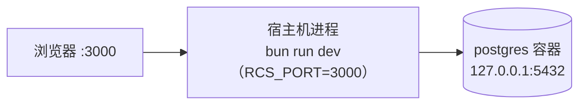
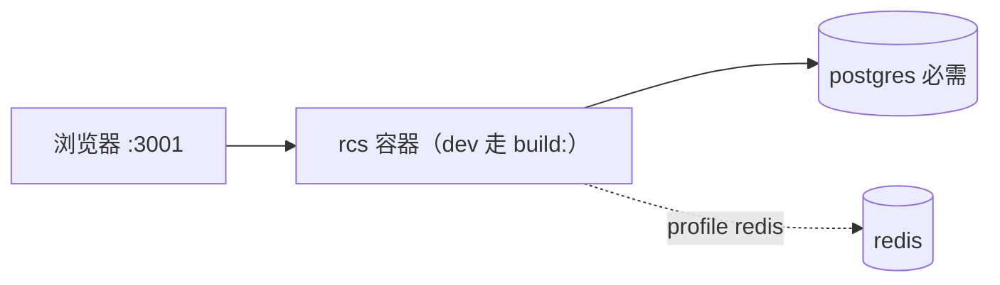
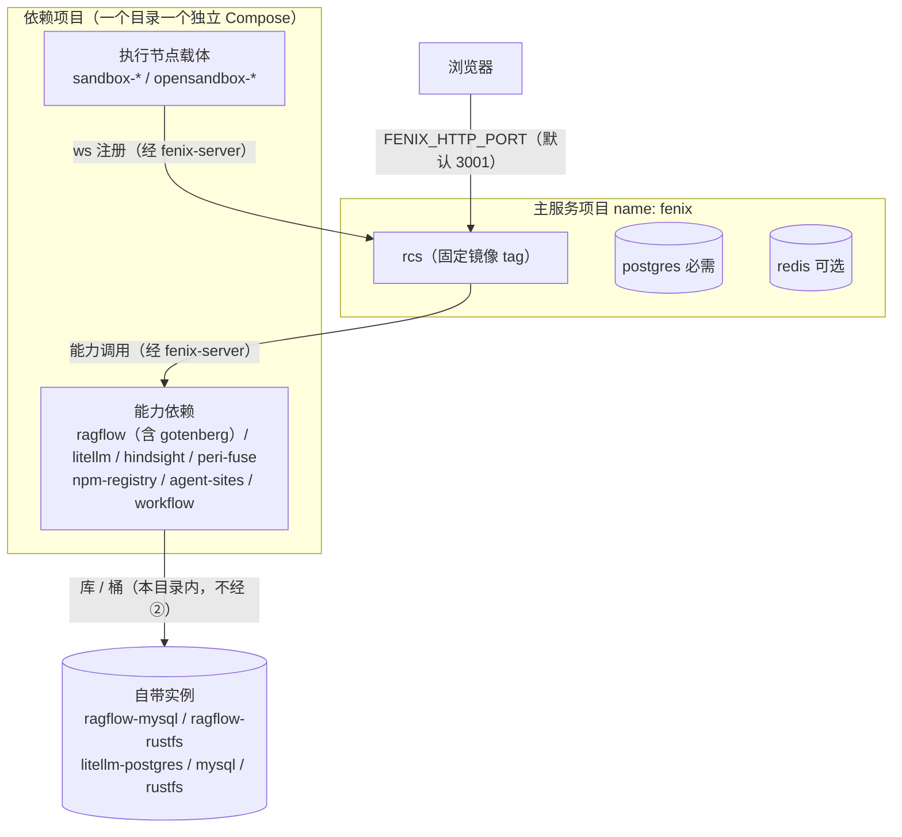
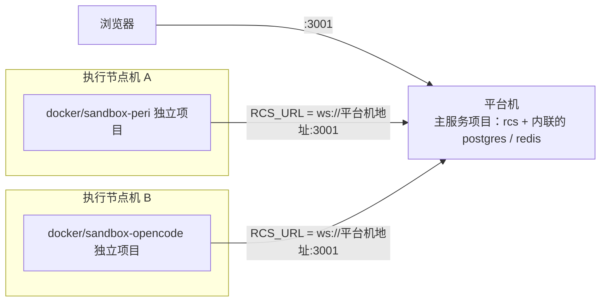
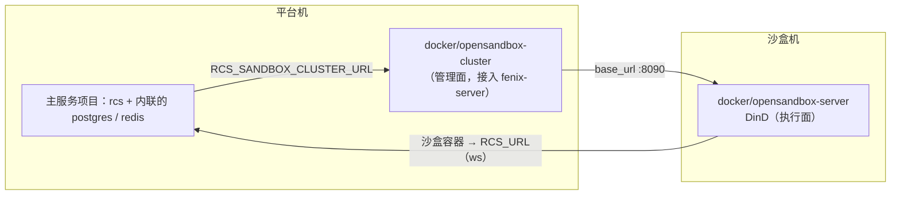

# Docker 部署架构与拓扑（权威）

> 状态：现状基线（2026-10-16）。
> 范围：FenixAgent 的 Docker 部署体系——编排结构（主服务编排（基础服务内联）/ `docker/<name>/` / 交付面）、网络分层、四种部署方式（本地开发 / 生产单机 / 执行节点分离 / OpenSandbox 分离）及各自的容器与网络拓扑、数据落点、配置与发布契约。
> 权威性：本文是部署**结构与拓扑**的权威。脚本用法、逐键配置说明与排障步骤见运维文档：[部署](../operations/deployment.md)、[Docker 编排体系](../operations/docker-topology.md)、[升级](../operations/upgrade.md)；OpenSandbox 集群的数据模型与接口见 [OpenSandbox Cluster 当前架构](./28-opensandbox-cluster.md)。
> 非目标：应用层运行架构（执行节点模型、ACP 信道、沙盒 Provider、Instance 生命周期）见 [沙盒整体架构](./19-sandbox.md)、[AgentController 编排域架构](./20-orchestration-management.md)；K8s 等平台的原生编排仓库不提供，其他平台以镜像 + `docker/main/.env.example` 清单接入。

## 1. 决策摘要

1. **主服务与基础服务只有一处归属**：主服务编排——dev 是仓库根 `docker-compose.yml`、生产是 `docker/main/docker-compose.yml`；每个可选能力 / 执行节点对应 `docker/<name>/` 一个独立 Compose 项目。
2. **dev / prod 各一份主服务编排**：dev 带 `build:`（本地构建），prod 不构建、只用固定 tag 的 `image:`；两份同项目名 `fenix`、同网络 `fenix-server`，**二选一运行**。
3. **网络两层**：各 Compose 项目的默认网络 + 唯一的共享网络 `fenix-server`；共享网络成员是最小必要集。
4. **每个组件自带依赖实例，没有共享实例**（2026-10-16 起）：主服务编排**内联** `postgres`（必需）与 `redis`
   （`FENIX_FEATURE_REDIS`），不再有共享基础服务编排；每个依赖目录自带它需要的关系库 / 对象存储 / 缓存实例
   （`docker/ragflow/` 的 `ragflow-mysql` / `ragflow-rustfs`、`docker/litellm/` 的 `litellm-postgres`、
   `docker/workflow/` 的 `mysql` / `rustfs`），实例只在**本项目默认网络**内被同目录的消费方访问——除主服务自己
   的两个基础服务外，没有需要跨项目按名寻址的实例，也没有跨项目启动等待（compose 的跨项目 `depends_on` 不成立）。
   库 / 账号 / 桶的创建仍归持有它们的目录（镜像环境键或它自己的一次性初始化服务）。dev 形态同形：`postgres` /
   `redis` 就地内联在仓库根编排（§2.1、§2.4）。
5. **一个开关对应一个目录**：`docker/deploy.env` 的 `FENIX_FEATURE_<NAME>` 决定依赖项目是否启动；未知开关是错误。
6. **一键入口 `./docker/deploy.sh`**：`init` / `validate` / `up` / `deploy` / `down` / `ps` / `logs`，任意机器只需 Docker + bash + 一份配置。
7. **数据一律 bind 挂载在各编排同级的 `./data/`**（不用命名卷）：备份 = 打包交付目录，搬迁 = 整目录拷走。
8. **版本与身份写死在文件里**：镜像 tag 在各 compose 的 `image:` 行，Compose 项目名写死 `name:`，都不做环境变量插值。唯一例外是**版本键**（2026-10-10 登记）：依赖目录可把 tag 写成 `${<NAME>_VERSION:-<缺省 tag>}`——缺省值仍在 compose（git 里看到的就是默认版本），覆盖只写在该目录自己的 `.env`，不进 `docker/deploy.env`；已登记 `docker/peri-fuse/` 的 `PERIFUSE_VERSION`。
9. **发布顺序固定**：DDL 迁移 → 数据迁移 → 应用启动；主服务容器启动命令含 DDL 迁移，数据迁移由发布任务承担。
10. **部署方式的差异只在「哪些目录出现在哪台机器」**：单机 = 全部目录一台机器；分离 = 主服务留平台机，执行节点 / OpenSandbox 目录放独立机器，跨机用宿主可达地址连接。

## 2. 编排结构

### 2.1 三层职责

| 层 | 内容 | 生命周期 |
| --- | --- | --- |
| 主服务项目 | 主服务 `rcs` + **内联**的基础服务 `postgres` / `redis`（dev 与生产各一份）；生产用 `docker/main/docker-compose.yml`（无 `build:`、不 `include` 任何文件），dev 备好仓库根 `.env`（填 `RCS_API_KEYS`）后 `docker compose up -d`（仓库根文件；组件零配置）即最小可用集（rcs + postgres） | 与部署同生共死 |
| 依赖目录 | 可选能力与执行节点（`docker/<name>/`，一个目录一个独立 Compose 项目） | 独立起停、独立升级 |
| 交付面 | `docker/deploy.sh` + `docker/deploy.env` + 上述文件 | 随版本发布 |

### 2.2 仓库布局

```text
仓库根
├── docker-compose.yml          # dev 形态主服务编排（带 build:，本地构建）
├── .env / .env.example         # dev 的应用配置与密钥（根编排与 `bun run dev` 读它）
├── data/ workflow/ workspaces/ # dev 运行期数据（bind 挂载点，不进版本控制）
└── docker/
    ├── main/                   # 生产形态主服务编排（无 build:，只用发布镜像；数据落 main/ 下同名目录）
    │                           # 应用配置与密钥是它同目录的 .env（模板 .env.example，deploy.sh init 落成）
    │                           # 基础服务 postgres / redis 内联其中，数据落 main/data/
    ├── deploy.sh               # 一键入口
    ├── lib/config.sh           # 配置解析、必填项校验、依赖发现（被 deploy.sh source；交付面必须带上）
    ├── deploy.env / .example   # 部署配置（只有开关；.example 是生成物）
    ├── ragflow/  litellm/  hindsight/  peri-fuse/  npm-registry/  agent-sites/  langbot/
    ├── workflow/               # Workflow V2 上游栈
    ├── sandbox-peri/  sandbox-dsh/  sandbox-ccb/  sandbox-opencode/   # 执行节点（引擎沙箱）
    └── opensandbox-cluster/  opensandbox-server/  opensandbox-server-tunnel/
```

### 2.3 主服务项目（`docker/main/docker-compose.yml`；dev 形态是仓库根 `docker-compose.yml`）

```yaml
name: fenix   # 固定项目名，不做插值：卷与容器都带项目名前缀
networks:
  fenix-server:
    name: fenix-server      # 主服务层网络（§3），唯一共享网络
services:
  postgres:                 # 内联的基础服务（dev 根文件同形，参数逐字相同、数据各自一份）
    image: postgres:16-alpine
    networks: [fenix-server]
  redis:
    image: redis:7-alpine
    profiles: ["redis"]     # 可选，开关 FENIX_FEATURE_REDIS
    networks: [fenix-server]
  rcs:
    image: ghcr.io/huangpustar/fenixagent:sha-<...>   # 固定版本；发布时更新本行
    networks: [fenix-server]
```

要点：

- `rcs` 的启动命令为 `bun migrate.js && exec bun --no-install run dist/index.js`——DDL 迁移先于应用进程。
- **两份文件的差异有两处**：`build:` 段（仅 dev，文件在仓库根、带 `build: { context: ., dockerfile: Dockerfile }`；
  生产文件不声明，目标机没有源码与 Dockerfile）、数据落点（dev 挂仓库根的 `./data`、`./workflow`、`./workspaces`；
  生产挂 `docker/main/` 下的同名目录）。两份都**就地内联** `postgres` / `redis`，`docker/main/` 不 `include` 任何文件。
- **手动执行生产文件读同目录的 env**：compose 的项目目录是 `docker/main/`，插值与 `env_file` 都读那里（`docker/main/.env`），
  所以在任意工作目录执行 `docker compose -f docker/main/docker-compose.yml …` 即可，不需要 `--env-file`；经
  `./docker/deploy.sh` 时读的是同一份文件（脚本读入后连 `docker/deploy.env` 一起导出为 shell 环境）。
- 数据挂载：`./data/peri-home`、`./data`、`./workflow`、`./workspaces`（全部相对编排文件）。
- 宿主端口：`FENIX_HTTP_PORT`（默认 `3001`）→ 容器 `3000`；`depends_on: postgres: { condition: service_healthy }` 直接可用（同属主服务项目）。
- **保留名只有 `postgres` / `redis`**：它们由本文件声明，是 `fenix-server` 上的跨项目 DNS 名；依赖目录可以定义同名服务，
  但不得接入 `fenix-server`（`mysql` / `rustfs` 不再是保留名，见 §2.4 与 §3）。
- 本文件不引用任何依赖目录的文件与路径（主服务 `config` 在任何机器上都要能解析，包括没装依赖的机器）。

### 2.4 基础服务与各栈自带的依赖实例

内联在主服务编排里（§2.3）的基础服务只有两个：

| 服务 | 必需性 | 缺失后果 | 开关 |
| --- | --- | --- | --- |
| `postgres` | 必需 | `DATABASE_URL` 必填无默认值，缺失即启动失败 | 恒启动 |
| `redis` | 可选 | 缓存回退进程内 Map；Y.Doc 快照不做持久化 | `FENIX_FEATURE_REDIS` |

两者都接入 `fenix-server`，数据 bind 到生产 `docker/main/data/{postgres,redis}`（dev 形态是仓库根的
`./data/{postgres,redis}`）；服务名是 `fenix-server` 上的保留名（§3）。`postgres` 的宿主端口由 `POSTGRES_PORT`
控制（只绑回环，供本地源码开发与运维排查），`redis` 不发布宿主端口；两者的消费方都只有 `rcs`
（`DATABASE_URL` / `RCS_REDIS_URL`）。

**其余依赖实例由每个组件自带**：`docker/ragflow/` 的 `ragflow-mysql` / `ragflow-rustfs`、`docker/litellm/` 的
`litellm-postgres`、`docker/workflow/` 的 `mysql` / `rustfs`。它们随各自目录的 Compose 项目启停，只在项目默认
网络内被同目录的消费方访问，凭据写在该目录自己的 `.env`；`docker/ragflow/` 保留带前缀的服务名，避开
`postgres` / `redis` 与后续可能出现的同名组件（逐项对照表与数据落点见
[Docker 编排体系](../operations/docker-topology.md) §5.1）。2026-10-08 ~ 2026-10-16 曾把这些辅助服务收敛到一个共享
编排 `docker/common/`，该形态已整体退役（记录见 [编排体系](../operations/docker-topology.md) §5 / §14.20）。

**实例的初始化归持有它的目录**：能由镜像环境键一次建好的（`POSTGRES_USER` / `POSTGRES_DB` /
`MYSQL_DATABASE` / `MYSQL_USER`）就直接建（`litellm-postgres` / `ragflow-mysql`，不需要初始化服务）；
需要落 schema / 建桶 / 展开初始化资产的，由该目录的**一次性初始化服务**承担（`docker/workflow/` 的
`assets-init` + `atlas-init` + `mysql-init` + `s3-init`、`docker/ragflow/` 的 `ragflow-s3-init`——workflow 的前两个
把随 server 镜像交付的初始化资产展开到宿主、再做 Atlas schema 收敛，2026-10-14 起它的部署不再需要 clone
上游源码）。因此每个依赖目录都是**自足**的：一条 `docker compose up -d` 起全栈，不依赖主服务项目先起，
也没有跨项目 `depends_on`（compose 不支持，本体系也不再需要）。

**Elasticsearch 留在 `docker/workflow/`**：它是该目录自带的栈内服务（数据落点、健康检查与上游插件 / 索引模板
都在那里），是需求方的明确裁定，不是遗漏；缓存同理各栈自带——RAGFlow 的 `ragflow-redis` 与主服务的 `redis`
是两个实例。

### 2.5 依赖目录契约（`docker/<name>/`）

每个依赖目录必须满足（逐条细则与自检清单见 [Docker 编排体系](../operations/docker-topology.md) §6）：

1. `docker-compose.yml` 是唯一入口，目录自包含；以**独立项目**方式启动，不与主服务 `-f` 叠加。
2. 网络按 §3 分层：需要与主服务互通的服务接入 `fenix-server`（`external: true`），服务名全局唯一；栈内辅助服务（数据库、缓存、对象存储等，含自带的依赖实例）不声明 `networks`，留在项目默认网络。
3. 宿主端口只绑回环或不发布；站点等对外入口一律经主服务反向代理暴露，不直接发布依赖服务的宿主端口。
4. 数据 bind 到本目录同级的 `./data/`；禁止命名卷。
5. 自带 README（用途、配置、网络接入清单、验证命令）与 `.env.example`（必需 → 可调 → 默认三段式）。

## 3. 网络分层

两层网络，职责不重叠：

| 层 | 网络 | 成员 | 可见性 |
| --- | --- | --- | --- |
| ① 项目内层 | 各 Compose 项目的默认网络 | 项目声明的全部服务 | 仅同项目内互相可见 |
| ② 主服务层 | `fenix-server`（主服务项目创建） | `rcs`、主服务编排内联的 `postgres` / `redis`、各依赖中需要与主服务互通的服务 | 网络内全部容器互相可见（跨项目） |

成员判定标准唯一：**这个服务是否需要与主服务（或需要访问主服务的执行节点）直接通信。**

- 必须接入 ②：`rcs` 与它的两个基础服务 `postgres` / `redis`；依赖的对外出口服务（RAGFlow API 与同栈的 `gotenberg`、`litellm`、`hindsight`、`npm-registry`、`agent-sites`）与观测服务 `peri-fuse`（上报方是 Agent 进程：本地执行在 `rcs` 容器内、沙箱节点在各自容器内，按服务名直连它）、Workflow 的 `coze-web`（平台侧唯一出口——`coze-server` / `milvus` 与它自带的实例都只在项目默认网络内）、sandbox / opensandbox 的管理面与节点）。
- 不得接入 ②：依赖栈内部的辅助服务（数据库、缓存、对象存储、消息队列、搜索引擎、向量库等），**包括各目录自带的依赖实例**——RAGFlow 的 `ragflow-redis` / `infinity` / `ragflow-mysql` / `ragflow-rustfs`、LiteLLM 的 `litellm-postgres`、Workflow 的 `redis` / `elasticsearch` / `etcd` / `milvus` / `mysql` / `rustfs`。它们只在 ① 内被本项目的出口服务访问，没有例外。
- 同时挂在 ① 与 ② 上的容器，遇到同名服务时 Docker DNS 没有优先级约定；因此 `postgres` / `redis` 是 `fenix-server` 上的保留名——依赖目录可以有同名服务（`mysql` / `rustfs` 已不属保留名），但**一律不得接入 `fenix-server`**；确实要接入 `fenix-server` 的实例必须换名（`litellm-postgres`、`ragflow-mysql` / `ragflow-rustfs`）。
- 依赖项目里只有显式声明 `networks`（`external: true`）的服务进入 ②；接入 ② 的服务名是跨项目 DNS 名，必须全局唯一。
- ② 由主服务项目定义并创建，依赖只引用——**依赖启动前主服务必须已启动**（顺序不变量）。
- 跨机通信不走 `fenix-server`（该网络只在单机 Docker 内成立），走宿主可达地址（`RCS_URL`、`RCS_SANDBOX_CLUSTER_URL`、`FRP_PUBLIC_ADDRESS`）。

## 4. 部署方式与拓扑

四种方式共用同一套编排文件与配置契约，差异只在「哪些目录出现在哪台机器」与「跨机地址怎么填」。

### 4.1 本地开发

#### 4.1.1 源码运行

只有数据库用 Docker，后端在宿主机跑源码。



```bash
docker compose up -d postgres     # 仅数据库
bun install
bun run db:migrate                # DDL 迁移
bash restart-server.sh            # 停旧进程 → build:web → bun run dev
```

后端挂载 `apps/web/dist/`，页面看到改动必须 `bun run build:web`；前端单独热更新用 `bun run dev:web`。

#### 4.1.2 容器全栈



先备好仓库根 `.env`（填 `RCS_API_KEYS`），`docker compose up -d --build` 即最小可用集（rcs + postgres）；
`--profile redis` 附加可选缓存。dev 根编排与生产一样只内联 `postgres` / `redis`，其余依赖实例由对应的依赖目录
自带（§2.4）。与生产单机是**同项目名、同网络的两份文件**（dev 根文件 / 生产 `docker/main/`），二选一运行。

### 4.2 生产单机

全部目录在同一台机器：主服务项目（主服务 + 基础服务，`docker/main/docker-compose.yml`）+ 按 feature 开关启动的依赖项目。



```bash
./docker/deploy.sh init        # 生成 docker/deploy.env 与各依赖 .env（已存在则跳过，绝不覆盖）
./docker/deploy.sh validate    # 按提示补齐必填项，直到这一步通过
./docker/deploy.sh deploy      # 拉镜像 → DDL 迁移 → 数据迁移 → 启动
```

最小交付面（目标机**无需源码与 bun**）：`docker/main/`（生产编排 + 同目录 `.env` + 模板 `.env.example`）、`docker/deploy.sh`、`docker/lib/`、`docker/deploy.env`、启用的依赖目录。

### 4.3 生产 · 执行节点分离

平台机只放主服务项目；`docker/sandbox-*` 以独立交付目录部署在一台或多台执行节点机上，容器内 runtime 主动出网连主服务（`RCS_URL`）。



- 节点机填 `RCS_URL`（平台机可达地址）、`RCS_SECRET`（与主服务 `REGISTRY_SECRET` 同值）、`RCS_MACHINE_ID`（控制台预创建或自动创建）三项即可 `docker compose up -d`。
- 节点容器不发布宿主端口，只出网，无需为节点开放入站端口；跨机时不依赖 `fenix-server`。
- 节点机的 `./data/` 与工作区是该机器自己的数据落点，随该机交付目录备份/搬迁。

### 4.4 生产 · OpenSandbox 分离

把沙盒的创建、调度与销毁交给独立的 OpenSandbox 沙盒机：管理面（Cluster）与执行面（Server）可以都在沙盒机，也可以把 Cluster 留在平台机。业务沙盒容器仍通过 `RCS_URL` 回连主服务。



三种部署变体：

| 变体 | 编排 | 适用条件 |
| --- | --- | --- |
| direct | Cluster 在平台机（`docker/opensandbox-cluster/`），Server 在沙盒机（`docker/opensandbox-server/`） | Cluster 能访问 Server 的 `base_url`（沙盒机开放管理端口与沙盒端口段） |
| tunnel | Server 换用 `docker/opensandbox-server-tunnel/`（frpc 主动连 Cluster 侧 frps 的 `FRP_BIND_PORT`） | 沙盒机无法提供入站端口；该目录不接入 `fenix-server` |
| 三合一 | 沙盒机用 `docker/opensandbox-cluster/deploy/`（Cluster + frps + Server 同机，自建 `opensandbox` 网络） | 不跑平台的独立沙盒机、离线交付；平台只配 `RCS_SANDBOX_CLUSTER_URL` 指向该机 |

同机部署（作为单机形态的扩展）也支持：`FENIX_FEATURE_OPENSANDBOX_CLUSTER/SERVER` 开关随主服务一键启动，`RCS_SANDBOX_CLUSTER_URL=http://opensandbox-cluster:8080` 经 `fenix-server` 调用。

## 5. 配置与环境文件

| 文件 | 内容 | 说明 |
| --- | --- | --- |
| `docker/main/.env` | 生产主服务的应用配置与密钥，以及主服务自带基础服务的凭据（`POSTGRES_PASSWORD`） | 与生产编排同目录、compose 自动加载；模板 `docker/main/.env.example` 是生成物，`deploy.sh init` 落成 |
| 根 `.env` | dev 形态的应用配置与密钥（含同一份基础服务凭据） | 根编排与 `bun run dev` 读它；键与逐键说明的真相来源是代码声明（宿主 `env.ts` + 各模块 `envDefinitions`）；`.env` 不进版本控制 |
| `docker/deploy.env` | 依赖开关（`FENIX_FEATURE_*`，含主服务可选服务 `REDIS`；共 17 个：16 个目录开关 + `REDIS`） | 模板 `deploy.env.example` 是生成物；端口等主服务编排插值键写在 `docker/main/.env` |
| `docker/<name>/.env` | 依赖私有键，含该目录自带实例的凭据（`LITELLM_DB_PASSWORD`、`WORKFLOW_MYSQL_*` / `WORKFLOW_S3_*` 等） | 各目录自带 `.env.example`，三段式排序 |

规则：

- 密钥只进 `.env`：不进 `deploy.env`、不进 compose 文件、不进 git。
- 必填项的真相只在 compose 的 `${VAR:?}`；`up` / `deploy` 在动任何容器前先过这道校验；`init` 只创建缺失文件，绝不覆盖已有 `.env`。
- 两层开关不得混淆：应用装配 profile（`deploy/assembly/<profile>.json`，`RCS_ASSEMBLY_PROFILE_PATH` 覆盖）决定启动期**加载哪些模块**；部署 feature 开关决定**启动哪些依赖服务**。两者按能力名对齐但不做自动映射。
- 控制台模块能力以 assembly profile 为唯一启用来源：浏览器运行期只使用构建时已包含且服务端清单声明的交集；清单加载失败可回退构建集以保持可用，但不改变服务端授权或模块装配。

## 6. 数据落点与交付面

- 数据落点 = 各编排文件同级的 `./data/`：主服务（含它内联的 `postgres` / `redis`）在 dev 落仓库根的 `data/`、
  `workflow/`、`workspaces/`，生产落 `docker/main/` 下的同名目录；其余实例的数据落在各目录自己的
  `docker/<name>/data/**`（`docker/litellm/data/postgres`、`docker/ragflow/data/{mysql,rustfs}`、
  `docker/workflow/data/{mysql,rustfs}`——workflow 的库 `opencoze`、ragflow 的库 `rag_flow` 与各自的桶都在
  各自实例里；ES 落在 `docker/workflow/data/elasticsearch`），都随交付面一起备份与搬迁。全部 bind 挂载。
- 交付面 = `docker/main/`（生产主服务编排 + 同目录 `.env`）+ `docker/deploy.sh` + `docker/lib/` + `docker/deploy.env` + 启用的依赖目录（各自带实例与数据）；运行期数据就在这份目录里。
- 交付面由 `./docker/deploy.sh export <目标目录>` 产出：受版本控制文件的快照，落在**仓库之外**，本机配置与数据不进交付面（由目标机上的 `init` 落成）。部署与升级都在那份副本里执行——在仓库工作区里跑会被下一次拉取、切分支或 `clean` 就地改写运行中的编排，因此 `docker/deploy.sh` 守卫在工作区内只放行 `export`：配置与发布（`init` / `validate` / `up` / `deploy` / `config`）直接拒绝，停止与查看（`down` / `ps` / `logs`）只告警。判据是 `git rev-parse --show-toplevel`（部署机上没有 git，自动放行）。
- 备份 = 打包交付目录（跳过容器与镜像）；搬迁 = 整目录拷走；`data/`、`workspaces/` 等必须进 `.gitignore`。

## 7. 发布与升级

- 主服务升级：更新 `docker/main/docker-compose.yml` 里 `rcs` 的 `image:` 行到目标 tag（dev 根编排的同一行同步；进版本控制、经评审合入）→ 交付该文件 → `./docker/deploy.sh deploy`。应急时可直接改目标机文件，事后必须把同一 tag 回写仓库。
- 依赖升级独立于主服务：改对应目录的镜像 tag 后单独 `up -d`；主服务重启不会顺带升级依赖。
- 自带实例的依赖（`ragflow` / `workflow` / `litellm`）升级时，实例与本栈的一次性初始化服务会按项目内
  `depends_on` 顺序先跑一遍（幂等，只同步口令、不动已有数据）；验收看它的 `Exited (0)` 与日志末行的完成行——
  它失败时该栈的主服务不会启动。
- 发布顺序：DDL 迁移 → 数据迁移 → 应用启动，任何路径不得颠倒；数据迁移不写进容器启动命令。

## 8. 部署不变量

1. 主服务编排是主服务与基础服务 `postgres` / `redis` 的唯一归属，这两个名字是 `fenix-server` 上的保留名：依赖目录可以有同名服务，但不得接入 `fenix-server`（`mysql` / `rustfs` 不再是保留名，留在项目默认网络内即可，如 `docker/workflow/`；要接入 `fenix-server` 的实例必须换名，如 `litellm-postgres` / `ragflow-mysql` / `ragflow-rustfs`——理由与边界见 [编排体系](../operations/docker-topology.md) §5）。
2. 网络只有两层；共享网络名唯一 `fenix-server`；接入它的服务名全局唯一（各目录自带的依赖实例一律不进 ②）；依赖启动前主服务必须已启动。
3. 依赖目录以独立项目启动，禁止与主服务 `-f` 叠加。
4. feature 开关与依赖目录一一对应，未知开关报错。
5. 发布顺序 DDL → 数据 → 应用，不得颠倒；数据迁移不进容器启动命令。
6. 密钥只进 `.env`。
7. 镜像 tag 与 Compose 项目名写死在文件里，不做环境变量插值，不用 `latest`（版本键例外见 §1 决策 8）。
8. 数据一律 bind 挂载在交付目录内，禁止命名卷与匿名卷。**已知例外**（完整清单与理由见 [编排体系](../operations/docker-topology.md) §13 硬约束 8）：`docker/dev/docker-compose.opensandbox.yml` 的 `opensandbox-server` 把 DinD 状态目录 `/var/lib/docker` 挂成命名卷 `fenix_opensandbox-server-dind-docker`——DinD 内部状态（镜像 / 容器 / 卷）不需搬迁或备份，且 macOS 上 bind 进去会让 dockerd 在 overlay2 的 metacopy 检查处 chmod 只读文件系统而崩溃循环。移除条件：平台文件共享支持 dockerd 所需的 chmod，或节点改为非 DinD 形态。
9. Compose ≥ 2.20；`include`（现仅 dev 根文件使用，引 `docker/dev/` 组件）与独立启动文件的相对路径均相对其自身目录解析。
10. 每个依赖目录必须有 README 与 `.env.example`；新增依赖 = 新目录 + 开关登记。

## 9. 相关文档

| 文档 | 关系 |
| --- | --- |
| [Docker 编排体系](../operations/docker-topology.md) | 编排实现细则：目录契约自检、`deploy.env` 键表、env 规范、`docker/deploy.sh` 命令、发布与升级、旧体系退役记录 |
| [部署](../operations/deployment.md) | 依赖服务、环境文件来源、启动顺序与启动后自检（操作步骤） |
| [升级](../operations/upgrade.md) / [迁移](../operations/migration.md) | 镜像与代码升级、DDL 与数据迁移的先后关系与失败判定 |
| [备份与恢复](../operations/backup-and-restore.md) | 备份对象与恢复顺序 |
| [OpenSandbox Cluster 当前架构](./28-opensandbox-cluster.md) | 集群数据模型、接口、代理与错误一致性 |
| [沙盒整体架构](./19-sandbox.md) / [AgentController 编排域架构](./20-orchestration-management.md) | 应用层运行架构：执行节点模型、Provider 抽象、Instance 生命周期 |
