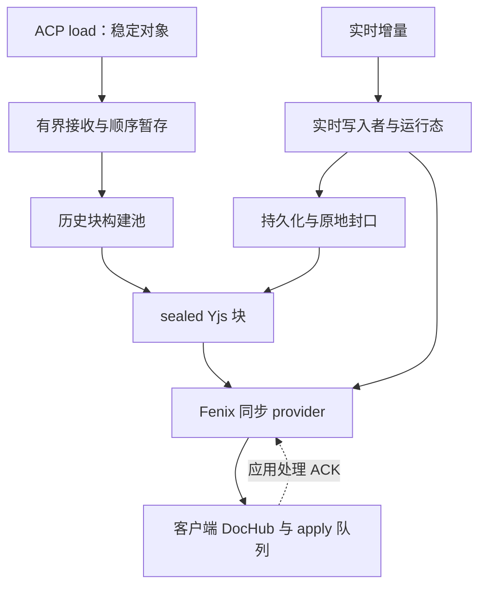
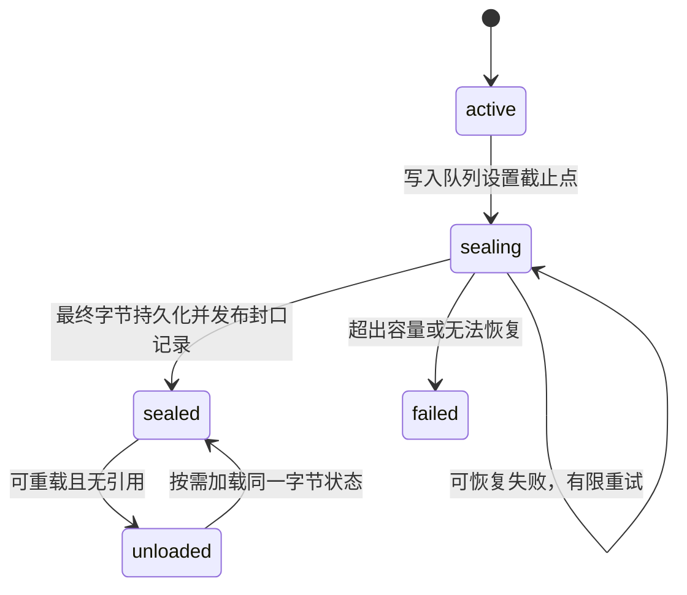

# FenixAgent 超长会话与高速输出同步架构设计

> 日期：2026-10-16。范围：设计交付，不修改 Peri 或 Fenix 源码，不执行数据库变更。
> 状态：完整方案，四位 Astra 两轮独立评审与交叉复核通过；评审记录及修订闭环见第17节。性能参数是待验证的验收配置，不是实测结论。
> 代码证据固定于 `94df4de6ff0ae4128dfdd42e8f4da96afe43f047`，来自部分源码镜像；不宣称覆盖后续 main 变更。

## 1. 决策摘要

1. **两个入口**：ACP `session/load` 输入完整、稳定的历史对象，走批量导入；实时输出输入增量，走实时写入。历史不重演 token、工具执行或审批。
2. **一种同步承载**：历史、实时和封口内容都用 Yjs 文档表达。采用多个有大小上限的独立 Y.Doc，共用身份、目录、持久化和同步协议。
3. **历史直接不可变**：历史对象按字节组成块，独立构建并持久化后直接发布为 sealed；构建过程不广播中间 update。
4. **实时原地封口**：active 内容块达到预算后停止写入并封口，保留同一 Doc ID 和 CRDT 状态，后续内容进入新块。
5. **调度由 Fenix 实现**：Yjs 提供增量、差分和合并；Fenix provider 负责有限队列、优先级、字节额度、应用确认和恢复边界。
6. **容量全链路有界**：入口、暂存、worker、持久化队列、服务端发送、客户端接收和驻留文档均有会话级及全局上限。容量不足明确暂停或失败，不静默丢数据。
7. **一次确定完整契约**：实现可以按模块并行开发，但必须通过整套门禁才能启用；不安排先上线残缺版再补正确性的路线。

### 1.1 用户约束

| 约束 | 设计响应 |
| --- | --- |
| Peri ACP 源不能修改 | 所有适配、暂存、分块和调度在 Fenix 及其可控 relay 内完成 |
| load 的每个对象已经稳定 | 不做历史事件归并、工具状态机回放、等待历史消息结束 |
| 历史仍须进入 Yjs 同步 | sealed 保存可直接 `Y.applyUpdate` 的二进制状态 |
| 历史不再修改 | 单写服务端禁止 sealed 写入；客户端无业务写入权限 |
| 空 session 持续运行 24h | 按字节及结构数量轮换内容块、运行态和目录页，不按整轮结束才切块 |
| 大 Markdown、多工具、多轮输入 | 逻辑消息与物理块分离；运行状态与正文分离；接收时绑定事件目标 |
| 前端渲染不是本次重点 | 改同步及投影接口；不重做 Markdown 渲染器、不恢复 100 消息窗口 |
| 暂不上 IndexedDB | 客户端释放后从服务端重新加载；不把浏览器持久化作为正确性前提 |

### 1.2 明确不承诺的能力

- 不承诺有限资源可无损接收任意速率、任意大小和无限时长的数据；支持范围由容量配置和测量确定。
- 不承诺 ACP 尚未发送到历史尾部时，Fenix 已经获得最新消息。
- 不把 Yjs 收敛等同于业务单写、持久化成功、授权或已收齐正文。
- 不把设计评审通过等同于代码、性能或生产验证通过。

## 2. 已核实基线与要替代的契约

| 基线事实 | 证据位置 | 新设计的变化 |
| --- | --- | --- |
| 文本/reasoning 默认 16ms 事件批处理，批内仍逐事件应用 | `state/doc-manager.ts` | 实时入口先合并相邻同目标文本；历史使用独立完整对象入口 |
| 广播合并同 microtask 的 Yjs updates | `channel/broadcaster.ts` | 保留共享编码能力，增加显式容量和任务调度 |
| `bufferedAmount > 64KB` 时标记落后，恢复发送整个注册 Doc 快照 | 同上 | 针对有界 Doc 补差；额度不足停止发送，不制造全会话巨型快照 |
| 客户端收到数据即同步 `Y.applyUpdate`；延迟的是投影重算 | `state/yjs-store.ts` | 将 apply 本身纳入队列；限制一次 apply 的输入 |
| Redis 尾随生成全 Doc 快照，默认 2s/500ms，TTL 7 天 | `persist/redis.ts`、`AGENTS.md` | Redis只承担缓存/通知；增加可恢复的同步投影存储 |
| Chat/Session 成对 generation 替换，DocHub 单点应用 | `doc-manager-projection.ts`、`web/yjs/doc-hub.ts` | 保留单点和成套替换，改为目录、运行态及内容块集合 |
| 批次错误存在记录“events lost”的路径 | `state/doc-manager.ts` | 提交失败不推进确认边界，保留重试依据或明确失败 |

以上不是最新 main 的性能测量。实施前以目标提交核对文件映射和接入点，不能重复引入已存在的能力。

### 2.1 对既有架构文档的显式修订

`docs/arch/19-yjs-chat-streaming.md` 和 `AGENTS.md` 中以下条款要在落地时同步修订：

| 旧约定 | 新约定 |
| --- | --- |
| 固定一对 `chat:` / `session:` Doc | 稳定会话定位 + generation + 有界独立 Doc 集合 |
| ready 前发送整个 Chat/Session 快照 | ready 前确认同一 generation 的入口、运行态及必需当前范围；全历史后台追赶 |
| 同 ACP session 一律跳过 load | 仅已提交且绑定有效的投影可复用；失败/中断/未知连续性不能误判已恢复 |
| 流式 delta 可以丢 | 可以合并发送，但逻辑内容不得丢；跳过的传输必须可由持久化状态补齐 |
| 不实现写者租约和日志 | 增加仅限同步投影的写者 fencing 与 active 二进制尾部，不新增业务事件总线 |
| Redis 是有界热投影 | 保留其缓存角色；PostgreSQL 持有可恢复的同步投影，不替代 ACP 业务事实源 |

保留确定性 `rcsSessionId`、实例/用户隔离、服务端唯一业务写入、显式 Action、shared relay 引用计数和浏览器安全包出口。正文完成不能触发历史工具重执行。

## 3. 架构与职责

| 模块 | 输入/输出 | 唯一职责 |
| --- | --- | --- |
| ACP 接收适配器 | 原始帧 → 历史对象或实时事件 | 校验、身份绑定、顺序编号、入口容量，保持请求响应顺序 |
| HistoryImporter | 完整历史对象 → staged sealed 块 | 按字节组块、有界并发、批次完成校验 |
| LiveWriter | 实时事件 → active updates / final records | 合并文本、绑定消息/工具、单块单写、控制事件屏障 |
| ProjectionStore | 文档字节/代际/目录 → 可恢复投影 | 原子提交、canonical 字节、fencing、校验和、回收 |
| SyncProvider | 已提交文档 → 连接任务 | 订阅、差分、优先级、额度、重连 |
| DocHub/ApplyScheduler | 更新 → 已加载 Doc | 单点 apply、generation 校验、ACK、驻留和释放 |
| Chat 投影适配器 | 已加载记录 → 既有视图模型 | 保持消息/工具身份和拼接顺序，不遍历全部历史处理每个增量 |

实现扩展 `@fenix/chat-channel` 的现有 owner，不另外建聊天服务、Kafka、通用工作流框架或第二套 CRDT。

## 4. 身份、顺序与数据模型

### 4.1 身份不能混用

| 字段 | 含义 | 生命周期 |
| --- | --- | --- |
| `scope` | 服务端鉴权后的 organization + rcsSessionId | 定位隔离范围，不接受客户端自行授权 |
| `acpSessionId` | Peri 内部会话 | generation 的绑定元数据，不独自作为授权键 |
| `generation` | 一次一致的同步投影 | 完整重建时改变；普通断线不改变 |
| `loadId` | 一次历史导入尝试 | 每次重试新建，不能充当源对象ID |
| `docId` | 一个独立 Y.Doc 的稳定身份 | 创建后到删除不变；与 Yjs `clientID` 不同 |
| `entryId / toolCallId` | 逻辑消息/工具身份 | 由已核实的源标识或 Fenix 边界映射生成 |
| `sourceOrdinal` | 本次 load 内对象顺序 | 只描述本次接收顺序，不证明跨次去重 |
| `updateSeq` | 某 Doc 已持久化 update 的连续序号 | 应用层顺序，不是 Yjs state vector |
| `writerEpoch` | 存储侧单写 fencing 版本 | 写者切换时增加 |
| `transportEpoch / deliveryId` | 单连接发送代次/帧编号 | 只用于流量确认，重连重新建立 |
| `subscriptionEpoch / syncAttemptId` | 同连接内某Doc的订阅/基线尝试 | 退订、resync、Doc实例变化即废止，不能复用旧游标 |
| `pointerRevision / referenceRevision` | 存储提交的会话入口/运行态引用单调版本 | 控制消息只接受更高版本或相同版本的一致重传 |

`docId` 创建时持久化，通常包含 generation 与块序号。恢复必须加载已有二进制；禁止只按相同 guid 重建一份新 Y.Doc 内容并合并到老客户端。不得复用 Yjs clientID 来“制造幂等”。

### 4.2 文档类型

| 文档 | 数据结构与用途 | 有界策略 |
| --- | --- | --- |
| 控制 Doc | 小型会话状态、当前目录页/运行态引用 | 元数据字节/事务数上限；到限换新的控制 Doc，连接握手返回入口定位 |
| 目录页 Doc | 有序sealed内容块与entry范围；相邻范围由存储索引定位 | 每页条目/字节上限；页满后原地封口，新页承接 |
| 内容 Doc | `Y.Array` 中的只追加记录 | 按字节、记录数、事务数轮换 |
| 运行态 Doc | 未结束消息、工具、权限的有限状态 | 完成后有序退出；按字节/事务数换代，未完成状态显式转移 |

采用**独立 Doc + 显式目录引用**，不强制把所有 subdoc 引用塞进一个根 Y.Doc。Yjs subdocs 是可用机制，不是必要依赖；本方案由现有 provider 复用一条连接多路传送文档。

业务载荷经保真JSON序列化成为UTF-8 `Uint8Array`，以扁平记录进入 `Y.Array`；仅受限的身份/顺序头使用普通JSON。这样不把每个静态字段做成嵌套Y.Map/Y.Text，也避免Yjs字符串编码改变孤立代理项。实时正文追加同样保真的不可变片段；工具可变的小状态位于运行态Doc。两种入口共用读取契约，允许 `history_object` 与 `text_part` 等不同记录种类。

记录至少携带：`recordId, entryId, entryOrder, contentSlot, partIndex, kind, payload/payloadRef`。其中 entryOrder 决定时间线位置，contentSlot 决定同消息内正文/工具位置，partIndex 决定片段拼接；任务完成时间和网络到达时间不能改变这些顺序。

### 4.3 大对象与内容保真

1. 普通历史对象以可还原完整JSON值的字节保存，不回放内部过程，不丢未知字段；校验不允许静默裁剪。规范化只改变表达，不trim、不Unicode normalize、不改变字符串代码单元；JSON中的孤立代理项保留为转义，数值遵循源协议解析契约，超出契约明确拒绝。
2. 超出块预算的对象，先形成逻辑对象描述，再将规范化序列化字节分为多个 `object_part`；记录总字节数、片段数量、摘要和内容类型。JSON 的值语义和数组顺序必须可还原，不承诺原始空白/键排列一致。
3. 长Markdown的物理片段不等于语义段落；代码围栏、链接和代理对可跨输入事件。保真JSON字节分片后按字节重组再解码；实时字符串片段按原始UTF-16代码单元顺序拼接，不擅自替换或补字符。
4. 一个逻辑对象只有在所需片段齐全且摘要通过后才标记完整；缺块显示未同步，不显示成空内容或完成。
5. 单个 ACP 原始帧本身仍有大小上限；下游分块不能消除一次超大 JSON 的接收/parse 峰值。超过限额，在可控最早入口明确失败。
6. 不对编码后的任意 Yjs update 字节片段分别调用 `applyUpdate`。网络分片只有重组意义；限制 apply 粒度必须在生成 Yjs 数据时完成。

### 4.4 逻辑对象定位、目录延伸与完整性

采用PostgreSQL派生范围索引 `chat_sync_ref`，键为 `(scope,generation,lookupKind,lookupId,contentSlot,partIndex)`，值只定位 `docId + recordId + 顺序范围 + 逻辑字节起止`；按entry/slot/字节起点建立范围查询索引，随机offset不能从part0顺扫。lookupKind区分entry、tool及最终描述；内容权威仍是canonical Yjs记录。每块最多2048条索引项，与块提交同事务；索引不另存正文，可由已提交块重建。

索引维修时冻结对应scope投影写入并固定generation/提交前沿，同时停止依赖索引的读取；重建后校验前沿与revision一致才开放，不能用旧扫描覆盖并发新增记录。暂停期间入口仍受§10容量和失败约束；恢复读写前重新验证ACP绑定与连续性，不宣称在线无阻塞修复。

接口固定为 `locateEntry(entryId)`、`readParts(entryId,slot,afterPart,limit)`、`locateFinal(entityId,minimumRevision)` 和 `readTimeline(afterOrder,limit)`。每页最多64项且响应≤32KiB；cursor绑定scope/generation，不能借cursor跨租户或换代。不得为了定位一个entry遍历全历史。

`EntityFinalDescriptor`统一覆盖消息和工具：实体ID、终态修订、状态、内容索引定位键、最后slot/part边界、总字节和内容摘要。最多4KiB；不包含所有分片数组。客户端按页遍历、流式校验，保留有限页和验证游标。执行完成、某请求范围完整、整个逻辑对象完整分别记录。

目录页**只追加已经封口的内容块引用**，当前active引用在控制入口中。目录导航采用存储范围索引定位前/后页，页面本身不存需要回写的next/prev指针；页满封口，后继页独立登记，分页查询根据同generation已提交范围找到后继。control只保存当前入口和少量定位字段，不能保存全部页列表。

### 4.5 客户端物化边界

DocHub pin的是有字节上限的请求范围，不是一个可见entry对应的所有历史Doc。已校验片段可顺序消费并释放，后续按索引重取；单个消息跨一万块仍可逐段同步、校验和导出。

同步投影提供 `readContentRange(entryId,slot,offset,maxBytes)`，每次≤1MiB；最终完整性使用分页遍历和增量摘要，不要求拼成一个无限字符串。普通完整JSON/Markdown物化最大16MiB，一次只还原一个对象，重组、解码与产物共用明确预算。超过16MiB的逻辑实时消息保持完整存储和范围读取，界面给出大内容范围访问/流式导出入口，不把截断文本冒充完整Markdown交给现有renderer。

这不是按消息条数截断历史。所有内容仍可访问；全文一次物化的资源上限必须真实表达。同步工作集预算不包含业务方在接口之外自行永久复制的全部正文，此行为不得用于本方案的有界验收。

## 5. 历史恢复：稳定对象的批量导入

### 5.1 入口和批次

1. `load_session` 进入前，获得 scope 的唯一恢复任务位置、入口内存/磁盘/worker 配额，建立 `loadId + staging generation`，再调用 ACP。
2. 同 scope 的重复恢复请求加入已有任务；不同目标会话的切换按现有命令协调器串行，不同时混写。
3. 每个完整历史对象接收时绑定 `loadId, generation, sourceOrdinal`。只做必要校验和轻量索引，随后顺序暂存；不调用实时 aggregator。
4. 暂存采用本机有配额的顺序分段文件，队列主要持有文件位置和长度。临时文件不是持久化事实：进程/磁盘丢失导致该批次失败，重新 load 新 generation。
5. 正常load中响应/控制不等待构建任务；过载处理以物理连接为边界，独立墙钟超时清理，不等待被暂停流中的RPC响应，详见§10。
6. 历史的工具对象只作为数据保存，不发起权限请求、执行工具或回放用户命令。

### 5.2 分块和构建

1. 按源顺序形成连续范围的工作块。构建任务在进入 worker 前预留输入、输出及复制开销；不能创建 20,000 个 Promise。
2. 每个块由一个构建者持有一个 Y.Doc；不同块并行。构建使用有限批量事务，observer 只服务构建统计，不接广播 provider。
3. 一个小块完成后生成 canonical snapshot、摘要和状态向量；同时记录范围、对象数、引用依赖。检查**实际编码大小**，超过上限则在未发布前重新分块。
4. 对新块做 create-if-absent 提交。同键异摘要视为冲突；若竞争已有提交，以已提交原字节为准，废弃未发布的重建物。
5. 只有持久化成功的块才可进入该 staging generation 的可用目录。任务可乱序完成，目录按 sourceOrdinal 排列并明确缺口。
6. 块提交完成后释放构建 Y.Doc 和已消费的暂存段；静态快照不需要一直保持成可变内存对象。

### 5.3 三种完成状态与原子切换

| 状态 | 判定 |
| --- | --- |
| `receivingComplete` | 同一有序接收入口观察到成功的 load 响应，记录最后 sourceOrdinal |
| `importComplete` | 截止边界的每个对象恰好出现一次、所有分片齐全、目录连续、所有引用可读且持久化完成 |
| `viewReady` | 客户端当前需要的目录/运行态/内容范围已应用；不要求全历史驻留 |

ACP v1 的 load 响应在历史发送之后；本地异步构建完成不能由 RPC Promise resolve 直接推断。接收边界必须在分派异步任务之前编号。[R5]

完整性验证通过后，一个存储事务同时校验expected current/epoch/资源有效性，写入新代committed及入口闭包、旧代retired、current指针与递增pointerRevision。提交后广播携带revision的替换通知。staging不对浏览器开放内容，只发送有界进度；旧视图只读保留，首次导入显示恢复进度。提交响应丢失时查询current/revision/new generation决定结果，不重做导入提交。

失败保留原 committed generation；首次恢复失败保持明确错误状态。重试新建 loadId/generation，不能直接把重放对象追加到旧目录。没有稳定源身份和版本时，不启用跨 load 增量去重；内容相同的两条消息都必须保留。

保留旧视图不等于远端ACP绑定已回滚。可发送命令的前置条件是 `(资源有效、ACP binding已验证、绑定session等于current generation、恢复状态ready)` 同时满足。切换/恢复失败将binding置unknown，冻结prompt和内容写入；迟到数据仍绑定失败loadId，不能投回旧generation。切回旧会话必须重新验证ACP绑定。所有共享relay的标签页执行同一guard。

### 5.4 历史与实时交接

- 浏览器重连且服务端已有有效 generation 时，直接同步投影，不再次调用 ACP load。
- 正在导入的scope允许有界暂存输入意图，明确显示“待提交”；此时只能返回received，不能返回committed。失败/断连明确退回可重试状态；重试沿用commandId且先查既有结果，不盲目再次执行。importComplete和绑定验证后才发送prompt，不等待浏览器补齐全部历史。
- load响应之后的实时事件绑定本次目标generation/loadId，可在有界live队列等待基础投影提交；队列阶段不发布终态、不声明持久。提交成功通过串行屏障交给唯一active writer；失去epoch、取消或导入失败时队列不能挪到下一次load。进程丢失这段队列意味着连续性未知，必须重新核实/恢复。
- 冷恢复时，若 Peri 把实时输出与历史对象无标记交错且无法建立明确分界，恢复必须失败并隔离该连接；不能猜测、按空闲秒数判断或把实时内容封成历史。该实际链路能力是强制集成门禁。
- 如历史最后一个逻辑消息还会继续，必须有可验证的源消息/工具身份建立continuation；没有可靠身份时停止不确定恢复并说明错误，不猜测追加到“最后一条”。

## 6. 实时写入与 24h 运行

### 6.1 写入前合并

只合并连续、同 `generation + turnId + entryId + contentSlot + 内容类型` 的文本增量。定时器从第一个增量开始，不使用会一直推迟的 trailing debounce；时间或字节阈值任一到达就提交。

工具、权限、错误、取消和终态形成语义屏障：之前已接收的对应文本先完成写入，再推进语义状态。不同消息、正文与 reasoning、工具前后的文本不可跨屏障合并。

一个事务产生的update先进入有界持久化尾部，成功后才发布。每个scope最多一个未决提交批次，提前固定batchId、各Doc序号区间、摘要和**原始update字节**。结果未知先查询：同批同摘要已存在则确认成功且不再执行输入；确定不存在且写权有效则重试原字节；异摘要/无法判定则停止写者。跨Doc批次在一个数据库事务提交全组，不能重试部分业务insert。Yjs transaction没有通用回滚承诺，异常内存Doc须从已提交原谱系恢复后才能开放读写。

实时写前预估载荷/操作成本并在软水位提前轮换；写后在私有未提交状态检查update和整个snapshot硬上限。意外超限不持久化、不发布：先确认该批确定未提交，恢复原canonical+tail并封口，再向新块写入已拆小的同输入；最多一次重新拆分尝试，仍超限报容量错误。不能拆已发布CRDT或靠网络分片遮蔽超大snapshot。

### 6.2 消息、工具和块的关系

- 内容块是物理存储单位，不是用户轮次。一个消息可以跨多个块，一个块也可装多个消息片段。
- 正文片段一旦写入就不更新；工具状态在运行态 Doc 按 toolCallId 更新，工具参数/结果中的大载荷进入内容块。
- 实体完成时，将final record、固定大小EntityFinalDescriptor和定位索引同事务持久化，再允许运行态移除。统一读取优先级为同实体最高有效修订的final descriptor优先于provisional运行态；大载荷未齐显示同步中，不让实体消失。
- 同一轮有工具等待权限，不阻止已经确定的正文块封口。
- 运行态只保留未结束或尚在交接的实体，设未完成条目数量与字节上限。源无限创建未结束工具时触发容量错误，不能不断扩大 active 状态。
- 多轮消息身份在接收时绑定。排队回调不能在执行时查“当前 turn”来决定旧内容归属。

### 6.3 运行态与控制 Doc 轮换

反复设置/删除键也会积累CRDT成本，不能认为当前键少就永久复用一个Doc。达到大小、累计事务或驻留时间上限后，创建新运行态Doc，复制未结束及持久交接未完成的实体，持久化后原子切换引用。

运行态轮换使用新docId，旧版停止写。发布 `(pointerRevision,referenceRevision,oldDocId,newDocId,requiredBaseSeq)`；客户端pin旧可见状态，等新版BASE_READY且缺失实体的小final descriptor已取得并校验后，一次投影提交切换，再释放旧版。仅拿到locator不算交接完成。运行态删除的实体同样先通过locateFinal取得小描述，再替换旧显示；大正文可后补。冷客户端从时间线/实体索引定位final，不依赖见过旧运行态。

新运行态复制未结束和索引交接尚未持久完成的实体；索引已提交后不必等所有客户端ACK才清理。客户端最多保留一个旧版和一个最新候选版，后续更高revision到来淘汰中间候选；交接占用单独有界预算，超时显示同步中并重取当前入口。旧Doc被GC后服务端返回stale-reference与新定位，不能返回空Doc伪装成功。

运行态存活载荷≤64KiB、最多256实体、每实体元数据≤1KiB（大参数/结果外置）；软轮换128KiB编码状态、硬限256KiB，预留新旧共存额度。复制后仍无法满足余量则明确容量错误，不无限轮换。控制Doc固定入口载荷≤8KiB，软32KiB/硬64KiB；不保存无限旧引用。正文不参与这些状态替换。

## 7. active → sealed 的完整协议

1. 单写队列确定 oldDoc 的最后输入位置和 finalUpdateSeq；此位置之前的合并缓冲完全写入 oldDoc。之后的输入绑定 newDoc，不能在异步封口完成时再猜归属。
2. 停止oldDoc新写入；先结清该Doc全部未决批次（包括提交结果未知的批次），确认从base到finalSeq已连续持久化。随后在写入路由事务内再次校验durable frontier等于finalSeq，登记 `oldDoc.sealing(finalSeq)`、唯一successor的新身份/初始状态和currentActive引用；事务完成后才写successor。仅预分配但未被路由引用的新Doc是孤儿。
3. 从已持久化的oldDoc最终状态生成canonical snapshot，记录最终序号、摘要、状态向量、编码长度和依赖。此时崩溃可凭已提交tail重建同谱系，不依赖旧写者内存；snapshot完成不阻塞successor已获许可的写入。
4. 存储事务校验 writerEpoch、expected lastSeq 和 oldDoc 状态，提交 sealed 状态及目录引用更新。已提交同摘要的重试成功；异摘要失败。
5. 客户端可能先收到封口元数据，也可能先收到尾部内容。封口元数据只表明服务端不可再写；客户端只有补齐最终序号对应内容并完成完整性检查后，才能标记本地完整。
6. 老客户端补缺失 update 或原 canonical snapshot，应用到同一 Doc；新客户端直接加载该 snapshot。不能删消息再插入、复制到另一个历史 Doc 或只留下最新 delta。
7. sealed 不等于立即销毁。队列/observer/provider/视图引用释放且可从存储重载后，才能卸载内存对象。
8. sealing 队列也有上限；持久化持续落后时停止增加新 active 工作，转为入口暂存/背压，最终容量不足明确失败。

跨Doc数据库提交不意味着客户端Yjs原子事务。`dependsOn`最多8项，只用于直接入口屏障；长消息完整性用固定大小final descriptor的索引定位键/终点游标/摘要，不枚举全部Doc。客户端最多64个在途依赖、每次64项分页验证；可先显示“执行完成，内容同步中”，不能把缺尾内容标成完整。

## 8. 统一同步 provider：Fenix 的实现责任

### 8.1 Yjs 与 Fenix 的分工

| Yjs 提供 | Fenix 必须实现 |
| --- | --- |
| update 编解码和幂等合并 | 路由、授权、generation/epoch 校验 |
| state vector 与缺失差分 | 任务队列、优先级、公平、额度与超时 |
| 事务、独立 Doc/subdoc API | 分块、不可变约束、持久化和封口 |
| `mergeUpdates` / `diffUpdate` | 业务完成边界、失败恢复和资源回收 |

差分只在同一 docId 的同一 CRDT 谱系使用。`mergeUpdates` 不能把不断增长的活历史变成固定内存；state vector 也不是应用层消息/删除完成证明。[R1–R4]

### 8.2 通道选择

选择复用现有已认证 WebSocket，一条连接多路复用多个有界 Doc。历史 snapshot 和实时 update 共享流量预算，避免再引入 HTTP 下载与 WS 两套完成确认协议。稳定快照可以被服务端缓存并共享，其不可变性不依赖 HTTP。

这是确定的实现选择，替代讨论中“历史 HTTP / 实时 WS”的候选。将来换传输不属于本次交付。

### 8.3 帧和握手契约

| 帧 | 核心字段/语义 |
| --- | --- |
| `HELLO` | 协议版本、会话绑定、generation、有限数量的已加载 Doc 状态；无状态使用显式标记，不把空字节当合法 state vector |
| `MANIFEST` | 当前generation、pointerRevision、referenceRevision、控制/运行态/目录入口、恢复状态；不携带全历史正文 |
| `SUBSCRIBE` | 申请有限 Doc/范围、优先级；服务端检查 scope、依赖与配额 |
| `DOC_BASE` | docId、generation、subscriptionEpoch、syncAttemptId、baseSeq、明确full/diff模式、payload摘要与编码长度 |
| `BASE_READY` | docId、generation、subscriptionEpoch、syncAttemptId、baseSeq；可信基线已建立才允许继续tail，与退额度ACK分开 |
| `DOC_UPDATE` | docId、generation、subscriptionEpoch、syncAttemptId、fromSeq/toSeq、payload；只发已持久化连续边界 |
| `SEALED` | docId、generation、subscriptionEpoch、syncAttemptId、finalSeq、最终snapshot摘要、依赖；不是客户端已完整证明 |
| `APPLY_ACK` | transportEpoch、deliveryId、processed/rejected结果；只按自身账本退额度，不信任客户端声明字节数 |
| `RESYNC` | docId、generation、旧subscriptionEpoch/syncAttemptId及新attempt；废止旧计划，重新协商base |
| `GENERATION_REPLACE` | 新generation、pointerRevision与入口；只接受更高revision或同revision一致重传，成套切换 |
| `ERROR` | 稳定错误码、是否可重试、scope安全上下文，不泄露正文/凭据 |

所有数据帧带协议版本、generation、docId、transportEpoch、subscriptionEpoch、syncAttemptId和deliveryId。订阅/resync在同WS内也换新attempt；废止旧任务并清队列，旧帧只结清原账本、不apply、不改变新游标。客户端只能通过当前鉴权握手/更高pointerRevision引入新generation，普通数据帧不能自行切换。

控制帧≤32KiB，数据帧含头≤288KiB，头≤4KiB、单标识≤256字节；禁止不受限的元数据/压缩展开。浏览器只提交Action、订阅和状态向量，不能上传业务Yjs update；服务端不能因任意Doc ID建立文档。异步任务每次入队/完成前检查目标版本；客户端revision校验负责挡住已经在途的旧控制通知。

### 8.4 差分与尾部的衔接

订阅单个active Doc时，在写入者串行屏障及一致存储读取中取得截止序号S和对应已提交状态。没有可信本地基线时，从空Doc应用校验payload摘要的完整snapshot；有已完成base和连续应用证明的本地Doc才可请求diff。发出SV前pin该实际Doc实例，并冻结该attempt的基线；实例改变、存在未定apply或本地修改时废止attempt，改走完整snapshot。

diff由服务端状态@S计算，必须实际应用返回字节（含delete-set）；不能因SV相等而省略。payload摘要只校验传输字节，不拿本地重新编码hash与canonical snapshot hash比较来判等价。`BASE_READY(attempt,S)`的前提是可信完整snapshot从空Doc应用成功，或pin住可信基线后正确应用对应diff；怀疑依赖缺失/pending则不READY，废弃副本重走完整base。apply返回和序号达到S本身均不足以证明基线完整。

BASE_READY之后才发送S+1起的连续已提交tail。完整性证明为“可信base + 同一attempt无缺口更新覆盖到finalSeq”；state vector仅帮助差分，不承担删除完整性、业务完成或传输ACK的证明。

不能先算快照再开始订阅而漏掉中间更新，也不能 base 构建期间无限缓存。尾部可从持久化存储读取；如果保留边界已越过客户端，改为新的有界 base。

每个 Doc 在一次连接同步过程中按应用层连续序号调度，跨 Doc 可并行排序。重复帧按 deliveryId 记账一次；重新应用同一 Yjs update 本身幂等。发现序号缺口、异代或依赖异常，停止该 Doc 的后续增量并申请补齐，不能长期将缺依赖 update 堆入 Yjs pending structs。

base/重连/补同步都必须先预留编码资源与发送窗口，零额度连接只保留有界任务引用，不触发编码风暴。旧base失效、退订或应用失败时关闭对应attempt；generation/entry身份不因局部重载而改变。

### 8.5 发送额度与公平

每连接维护控制、实时、当前历史、后台历史四类有界任务。正文任务按字节配额轮转；实时优先且给历史最低配额，避免持续输出导致历史饥饿。单 scope、单租户及进程都有额度，不能只限制单连接。

额度覆盖已发送未ACK字节且动态授予；512KiB是单连接最高值，不是200条连接同时预分配。发送前检查 `bufferedAmount + encodedFrameBytes <= socketHighWatermark`、连接outstanding和全局发送内存；wire/envelope均计费。ACK只归还同代次已记录帧，重复/未来/旧ACK不加额度；断连清账，重连重新握手。旧64KiB软阈值由明确的512KiB socket硬水位与全局窗口替代，原保护能力不被绕过。

慢客户端的待发送列表只保留有限范围和“需要追赶”的状态，不积累每个 token update。更新正文在持久化 Doc/尾部中可恢复；丢弃的是冗余发送任务，不是唯一内容。队列达到上限时停止实时订阅任务扩张，后续以该有界 Doc 的状态补差。ACK 超时断开单连接，不等待所有客户端才封口。

追赶由ACK、独立调度tick和订阅请求触发，不依赖下一条业务消息；dirty集合最多128个已订阅Doc，超限关闭连接并重新握手。控制流也限频，不能借高优先级绕过总预算。

### 8.6 客户端应用调度

1. `onmessage` 做边界校验并放入有界队列，不直接对每个包同步 apply。
2. DocHub 是唯一 apply 入口，按优先级和 Doc 连续边界选任务；一次调度处理有限字节/次数/时间后通过宏任务让出执行权。
3. `Y.applyUpdate` 同步执行，不能中途暂停；时间预算只能控制两次调用之间。单次成本由服务端块大小、结构数量和生成策略共同限制。
4. processed ACK必须在本次同步apply返回、任务序号/attempt校验完成并释放接收任务资源后发；入队、postMessage、worker收到任务都不能确认。rejected ACK只结清传输额度并进入resync/error，不推进base/appliedSeq。ACK不代表渲染、浏览器持久化或整个对象完整，BASE_READY与最终边界另证。
5. apply 异常时不发送成功 ACK，不继续使用不可信 Doc；申请从 canonical snapshot 恢复，失败关闭连接并清理该同步代次。
6. 已加载 Doc 按当前视图引用、活跃状态和容量释放。后台同步可验证后释放 sealed Doc，不能为了“全量同步”把所有历史永远常驻。

不使用无限递归 microtask 调度，不给每个 Doc 创建独立 WebSocket，不把大量 observer 全量扫描藏到 apply 后面。视图适配必须只处理受影响的块/entry；本次不更换 Markdown 渲染器。

## 9. 持久化、写者与恢复

### 9.1 明确选型

沿用现有 PostgreSQL 保存同步投影；Redis保留缓存和跨节点通知。新增关系均归 chat-channel 的宿主存储 adapter 管理，不增加新的数据库服务。

| 逻辑关系 | 关键内容 | 约束 |
| --- | --- | --- |
| `chat_sync_scope` | scope、currentGeneration、writerEpoch、owner、leaseExpiresAt、pointerRevision | 每scope一行；指针与fencing权威 |
| `chat_sync_generation` | scope、generation、acpSessionId、loadId、状态、导入终点、入口引用 | staged/committed/failed/retired显式；元数据有界 |
| `chat_sync_doc` | scope、generation、docId、kind、state、snapshot bytea、hash、baseSeq/finalSeq、range | 文档有尺寸上限；sealed字节不可覆盖 |
| `chat_sync_update` | scope、generation、docId、updateSeq、二进制update | 只保存active及封口清理宽限内尾部；唯一键保证重复提交不追加 |
| `chat_sync_ref` | entry/tool/最终描述的派生范围定位 | 与canonical记录同事务、分页读取；只存定位不存第二份正文 |

这是设计中的新增 schema 建议，不是已获准执行的 DDL。根据仓库规则，实际表结构/迁移须用户批准后执行；当前文档交付不修改数据库。

暂存文件不进入业务真相；PostgreSQL投影不驱动Agent重执行，ACP仍是业务事实源。持久性承诺限于现有数据库WAL/复制配置支持的故障域，本设计证明应用进程重启恢复，不擅自承诺灾难级零丢失。投影不能自动使失效Agent“恢复在线”。

### 9.2 写入原语

存储 adapter 至少实现以下具体原语，不暴露任意通用工作流：

- `acquireWriter(scope)`：数据库时间判断租约，增加 epoch，返回单写权。
- `appendUpdates(scope, epoch, batchId, expectedFrontiers, exactUpdates, indexes)`：校验owner/lease、current/staged允许状态、各Doc前沿；一个事务提交全组字节和索引。唯一身份含batchId/序号/摘要，查询未知结果后只重试原字节，异摘要失败。
- `putSealedIfAbsent(...)`：已存在只能返回相同 canonical 状态，不能重建覆盖。
- `sealDoc(expectedEpoch, expectedLastSeq, finalSnapshot, manifestChange)`：校验已登记唯一successor路由和终点，原子封口并提交目录定位；重启按持久路由选唯一写入入口。
- `commitGeneration(expectedCurrent, newGeneration, expectedEpoch)`：原子写新代committed/入口闭包、旧代retired、current和递增pointerRevision；GC优先保护current可达数据。
- `readDocStateAt(docId, seq)`、`readUpdatesAfter(docId, seq, limit)`：有界恢复/差分输入。
- `retireAndCollect(scope, generation/docId)`：生命周期标记与延迟删除。

并发控制在PostgreSQL事务内通过scope行锁/条件更新实现；写者epoch由存储校验，退役generation不得因epoch仍有效继续写。多个实例只有一个scope写者，读节点只分发已提交状态。续期失败立即停写；fencing不能撤回已在途通知，所以客户端以pointerRevision拒绝旧入口回退，同代已提交字节允许幂等重发。[R7]

### 9.3 active尾部与崩溃

生成update在持久化前处于内部私有状态；每scope最多一个未决批次。所有读取出口（差分、snapshot、Redis通知、目录、广播和committed Action Ack）只能观察已提交边界。同步读取在写入者屏障后或从一致存储snapshot+tail读取，不能直接编码尚未提交的内存Doc。

received Action Ack只表示有界接收，committed Ack必须由既有commandId去重/结果及对应投影提交支撑；ACP接受prompt、Agent执行完成与投影提交分别记录。已有命令设施无法提供此保证时，实施必须补齐其持久结果边界，不能把RAM队列称为已提交，也不通过自动重发未知副作用解决。

发生崩溃：加载原snapshot及连续持久化tail即可恢复原CRDT，不用业务对象重新生成同docId。已收到但未提交的数据不能被宣称已持久化；若ACP没有重传游标，重新load到新generation修复，不能承诺这段可自动精确续接。

恢复在一致数据库读取版本下取得snapshot/baseSeq和连续tail；并发压缩造成版本改变或缺口时重新取base，不继续拼接。LiveWriter的turn/entry/slot/partIndex、工具绑定和唯一currentActive都必须由这些已提交记录及路由元数据确定重建，不能只恢复可渲染文本。

封口事务提交后，即使广播丢失，客户端可从目录和doc状态发现封口。尾部压缩/删除必须在最终快照校验可读之后；落后客户端改用快照，不要求为每个离线客户端永久保存update链。

### 9.4 清理与生命周期

| 数据 | 回收条件 |
| --- | --- |
| 暂存文件 | 对应对象已形成可恢复块，或批次失败/取消；启动时清理孤儿任务目录 |
| 未发布worker产物 | 任务取消、超时、失去epoch或与已提交块竞争失败 |
| active尾部 | sealed snapshot可读且清理宽限到期；保持恢复原子性 |
| 旧运行态/控制Doc | 新引用已提交、旧文档停止写入、宽限期结束；重连只提供新定位 |
| retired generation | 不再current、无恢复任务引用、达到生命周期宽限；旧客户端收到重置而非无限保留 |
| committed历史块 | 会话/实例投影生命周期结束并完成现有清理契约；不得仅因缓存TTL删除仍可访问的引用目标 |

GC按数据库可达引用和状态进行，不能按“客户端都ACK了”决定永久删除。服务端缓存与客户端驻留独立限额。

浏览器断开、provider驱逐、服务重启、实例暂时离线均不是业务删除。真实删除通过现有权威资源生命周期：先持久禁止接入/写入并增加fencing，撤销任务和订阅，再异步删bytes。acquire/import/append/commit都检查资源有效性与删除状态；删除后不复用旧资源incarnation。可复用既有资源删除标记，无需另建tombstone表。普通保留/回滚窗口不覆盖真实授权删除请求。

## 10. 容量配置与过载行为

所有数字为固定的初始验收profile，尚未实测。允许在保留评审记录后调参，不能在一次验收中降低负载以宣称达标。协议中的身份、顺序、完整性和失败规则不随调参改变。

### 10.1 全局预留与阶段交接

单进程同步资源预留预算 **512MiB**，以下子池最坏预留之和必须等于或小于它。此值不等于全应用RSS上限：运行时、其他业务和GC余量另计，容量验收必须报告实际RSS/heap及放大系数。

| 子池 | 上限 | 包含内容 |
| --- | --- | --- |
| 大帧解析 | 128MiB | 同时最多1个>1MiB对象：raw、UTF-16解码、JSON对象/节点和有限输出；不同时保留全对象clone |
| 常规入口/暂存队列 | 64MiB | raw小帧、解码后对象、文件写入在途与队列；每load普通内存≤8MiB |
| 历史构建 | 64MiB | 两个worker输入、Y.Doc、编码产物及postMessage副本；执行+等待总任务≤6 |
| 热Doc/live未提交 | 64MiB | 所有scope当前Doc、运行态交接、live输入、未决批次及编码暂存 |
| 持久化/封口 | 32MiB | SQL参数与driver副本、重试原字节、最多4个在途事务、全局最多16个seal任务 |
| 传输/快照缓存 | 96MiB | 其中outstanding账本/发送任务32MiB、socket拷贝预留32MiB、共享snapshot缓存32MiB |
| 控制/索引/代际交接 | 32MiB | 控制帧、有限查询页、旧/新入口交接、任务元数据；不能存全历史索引 |
| 不可借用安全余量 | 32MiB | 已接纳任务的瞬时编码/释放延迟；不能据此扩大接纳窗口 |

交接一律先取得下一阶段额度，再入队，成功后释放上一阶段额度；发生复制时两边同时计费。不能拿着有限worker无限创建SQL/Redis Promise。数据库/Redis连接池离线队列必须关闭或有显式字节/请求上限；通知可合并为最高已提交revision，不能丢唯一内容。

内存预留覆盖解码和CRDT对象放大：按测量得到的保守上界配置，并用节点/结构硬上限约束输入复杂度；估算不足导致实际峰值越预算判验收失败。容量profile启用前校验所有子池、工作槽和最大任务能放入所属池，缺配置拒绝启用。

### 10.2 输入与数据单元

| 项目 | 固定起始上限/行为 |
| --- | --- |
| 原始ACP帧 | 16MiB，最早可控relay按framing字节计数，越界立即失败连接；主服务同限额 |
| JSON复杂度 | 深度≤64、节点≤65,536；解析前通过有界字节扫描检查，不在parse之后才限制；不改字符串值 |
| 大帧解析 | >1MiB由固定解析worker处理，共享128MiB池仅1个任务；源必须先拿到raw缓冲额度，不能在SDK内部无限排队 |
| 历史worker任务 | 输入以文件范围/有限字节传递；构建块目标128KiB载荷，编码snapshot硬限256KiB |
| 正文记录 | 扁平头≤4KiB，载荷片段≤16KiB；每Doc≤2048记录/2048事务，并监控实际CRDT结构数量 |
| 实时合并 | 首增量后最长33ms或16KiB，控制屏障提前提交；超时不意味着可无限累积，字节上限始终生效 |
| active正文 | 软水位128KiB载荷，snapshot/update编码硬限256KiB；写前留余量、写后发布前验证，见§6.1 |
| 运行态 | 存活元数据总和≤64KiB、最多256实体、单实体≤1KiB；soft snapshot128KiB/hard256KiB，轮换≤1个/scope |
| 控制Doc | 固定入口数据≤8KiB，soft32KiB/hard64KiB；大参数不进入控制Doc |
| 目录页 | soft128KiB/hard256KiB、最多2048引用；定位页≤64项且≤32KiB |
| 最终描述/依赖 | final descriptor≤4KiB，直接dependsOn≤8项；长依赖按索引分页，客户端同时≤64项 |

### 10.3 并发、磁盘和连接

| 项目 | 固定起始上限/行为 |
| --- | --- |
| 进程连接数 | 200，单scope≤8，单租户≤64；仍须先取得全局内存额度 |
| 活跃写入scope | 32/进程、8/租户的数量上限；只有资源预留成功才接纳，不保证全部上限可同时占满 |
| 活跃load | 2/进程、1/scope、1/租户；待启动队列最多16项，超过明确忙，未接纳前不调用ACP |
| load暂存 | 2GiB/任务、8GiB/进程，段大小8MiB；配额含尚未删除段，失败/完成后有界清理 |
| live等待 | 4MiB/scope、全局受64MiB热池约束；含load后等待提交的live，满则失败当前连续性，不伪装已确认 |
| sealing | ≤2块/scope、≤16块/进程；额外new active不能突破热池和未提交批次上限 |
| SQL事务 | 最多4个，2个保留live、1个保留history、1个可借用；每批编码参数≤1MiB，超时5s，重试最多2次且先查未知结果 |
| 连接正文窗口 | 动态授予，最高512KiB/32任务，受全局32MiB outstanding池限制；未授予的额度不能提前编码 |
| socket水位 | 512KiB，必须检查当前bufferedAmount+待发送完整帧长度；全局socket预留32MiB |
| 控制窗口 | 32KiB/连接且受全局32MiB控制池限制，100帧/秒；不能绕过全局接纳 |
| ACK/任务deadline | 30s无进展断开该连接；base/引用交接30s失败重订阅，所有计时独立于新业务事件 |

### 10.4 客户端预算

客户端同步预留总额 **128MiB**：接收/控制2MiB、Y.Doc驻留32MiB、投影片段16MiB、单对象重组/解码64MiB、索引/依赖/代际交接8MiB、安全余量6MiB。实际物化对象若复制给业务仍计入投影或重组池，不允许释放账本却继续持有无限副本。

- 接收数据队列≤1MiB/64任务，与最大授予窗口匹配；不启用未定义的压缩展开。
- Y.Doc≤128个且受32MiB驻留池约束，不能以条数上限替代字节/结构预算；同entry的旧片段不全部pin。
- 单次完整物化的逻辑内容上限16MiB、最多1个对象，并且保守估计的片段/UTF-16解码/JSON节点/产物峰值必须能放入64MiB池；16MiB并不保证必然可完整物化。客户端parse前也检查深度/节点和放大预算。单对象本身超过峰值预算立即走范围读取/流式导出，不能反复等待；只有任务本身可容纳但池暂忙时，允许最多30s的有界等待，然后明确重试或范围访问。
- 同时8个内容范围请求，单范围≤1MiB；投影片段LRU≤16MiB。完整性校验流式进行，不保留全对象依赖集合。
- apply每轮目标4ms后让出，但单次不可抢占；单apply时间和结构成本单独记录，超目标必须调整数据单元或实现，不能宣称4ms硬抢占。

### 10.5 公平与进展

解析/构建、持久化、发送分别有独立限额，统一按租户再按scope轮转。大帧解析一次不可抢占，任务完成后live/history交替，有一方空闲才借用；live小帧不排在历史构建队列中。历史有2个固定构建worker，live写入不占历史worker；主线程只做受限小任务，重编码在预留槽内执行。

持久化槽按上表保留份额。发送正文使用按字节的deficit round robin，实时/当前历史/后台历史权重 **8:3:1**，轮转量16KiB，额度可积累到一个最大帧；空队列额度可借用。控制流使用受限独立份额。同scope多连接不能放大其构建/落盘份额。

在§15标准负载下，已就绪历史任务任何一个阶段不得连续2s无服务；全部历史后台传输聚合吞吐至少256KiB/s，单个已接纳导入持久化吞吐至少1MiB/s。慢端/后台暂停不适用端到端延迟SLO，但仍适用容量与恢复正确性。

### 10.6 过载与物理连接边界

积压下界为 `累积接收字节−累积消费字节`。暂停读取只能限制我们可控制的链路，不能证明Peri内部缓冲有界。

1. 明确区分多个浏览器共享一个scope relay，以及多个scope共享同一物理ACP连接；暂停/关闭按实际物理连接执行，不假装能暂停其内部某scope。
2. 达暂存80%高水位且底层读取可暂停时，最多暂停2s；独立墙钟deadline始终运行，不等待同流load/取消响应。空间释放至50%再恢复。
3. 暂停不可用、预算耗尽或deadline到期，立即将本次导入/受影响连续性标失败。只有在有界framing阶段能可靠识别失败scope/load时，才允许最多2s的有限drain；drain仍经过大帧解析额度，不无限丢弃读取。
4. 无法安全分离、解析额度也满或drain超时，关闭整条物理relay；该流上所有scope均标同步中断，旧视图只读。关闭不等待ACP ACK，不等于杀死Agent。
5. 丢弃只发生在已明确失败并拆除的尝试，不能继续报告导入成功。再次恢复必须重新验证源绑定与连续性。

日志也须有界构造：不能先stringify整个16MiB工具对象再slice出500字。压力验证必须覆盖SDK内部读缓冲、driver离线队列、GC副本和worker inbox，不能仅检查自建队列。

## 11. 场景推演

### 11.1 空会话运行24h：大MD、多工具、多轮

| 时刻 | 数据流与约束 |
| --- | --- |
| U1提交 | 服务端唯一写用户意图/消息，绑定turn；不增加前端本地影子消息 |
| M1高速输出 | 合并同目标小增量，append到当前内容块；持久化后广播 |
| M1超块大小 | C1原地封口，M1后续片段进入C2，entryId和contentSlot不变 |
| T1/T2并行 | 工具状态各自更新运行态；内容块可继续封口 |
| T2返回巨大结果 | 稳定结果拆内容载荷块；final descriptor通过固定索引定位全部部分，缺块时标同步中 |
| T1等待授权 | 权限控制优先且绑定同toolCallId；不阻止正文历史封口 |
| U2到来 | 依既有Agent执行语义排队；本方案不擅自开启并发prompt |
| 第一轮终态 | 先提交尾部，再发布含依赖的终态；客户端执行完成与正文收齐分开 |
| 浏览器断线 | 后端不等待浏览器；tail/sealed持久化继续，发送任务有界 |
| 浏览器重连 | 同generation按订阅Doc追赶；必要时加载原canonical snapshot |
| 24h后 | 热写入仅触及当前内容块和有限运行态；历史存储随内容增长，热工作集受预算约束 |

历史全量索引扫描、每token对整个消息拼接、跨所有历史工具搜索终态，都不得位于新的热写路径。此处约束投影算法，不要求重写渲染组件。

### 11.2 20,000个稳定历史对象高速恢复

1. 预留任务配额后调用load，源按自己的速度传递完整对象。
2. 入口接收编号并暂存；构建池按字节块并行构建，完成块持久化后释放内存。
3. 浏览器显示恢复进度，保留旧只读视图；staging正文不对外开放，最新内容也只能在源发送到该位置后获得。
4. load响应只关闭接收边界，导入器继续完成剩余块。
5. 验证对象数量、顺序、载荷摘要和引用闭包，原子提交generation。
6. 浏览器切换到新generation，优先当前范围，背景历史同步共用额度。

### 11.3 同时恢复与实时输出

历史构建worker、入口/存储IO和provider后台份额都受全局配额。实时路径保留处理能力，历史获得最低吞吐份额；不能只给WS优先级而让历史JSON解析占满事件循环。

## 12. 故障矩阵

| 故障注入点 | 正确行为 | 禁止行为 |
| --- | --- | --- |
| load中途断线/错误 | staging失败，保留旧generation，新loadId重试 | 提前标loaded导致重试跳过 |
| 超大报文/磁盘满 | 明确错误，回收任务，保留诊断上下文 | 截断、丢对象后继续报告成功 |
| worker乱序/崩溃/超时 | 顺序由源序号确定，有限重试，失效产物丢弃 | 用完成顺序排历史、无限重建 |
| 块提交成功但响应丢失 | 查同键canonical字节并幂等确认 | 同docId生成新CRDT覆盖 |
| live持久化失败 | 不推进publishedSeq，不吞错，恢复原Doc或重建generation | 内存半提交后继续写、重复业务副作用 |
| seal持久化成功但通知丢失 | 目录/重连能发现sealed，补旧块尾部 | 误以为无通知就仍可写 |
| newDoc已出现而oldDoc尾部未到 | oldDoc标同步中，按依赖补齐 | 隐藏/删除旧块未同步尾部 |
| ACK重复、乱序或旧代次 | 按账本确认一次，拒绝未来ACK | 重复退额度导致超发 |
| 服务端双写/租约到期 | 存储拒绝旧epoch，旧写者停发 | 依赖CRDT自动“修复”两次业务写入 |
| generation切换中旧帧晚到 | 校验后拒绝，释放旧任务，保留新代次 | 把旧帧应用进新Doc |
| 客户端apply失败 | 不成功确认，销毁不可信副本并重载 | 后续更新继续堆入错误状态 |
| 权限撤销/跨租户docId | 停止发送、清理订阅，服务端拒绝读取 | 只在首次WS握手校验权限 |
| 临时缓存或Redis丢失 | 从投影存储恢复；ACP状态另验证 | 宣称Redis通知本身保证持久完整 |

## 13. 实现落点与复杂度边界

| 现有位置 | 必需改动 |
| --- | --- |
| `protocol/acp-channel.ts` / relay边界 | 保留源消息类型，完整历史对象与实时事件分流；接收边界编号与容量 |
| `channel/session-channel.ts` / coordinator | 恢复任务状态、失败可重试、generation提交、单写身份 |
| `state/doc-manager.ts` / projection | 文档集合、当前块、封口/替换协调；不继续全量单Doc |
| `state/chat-writer.ts` | append记录、逻辑entry/slot/part、工具运行态与final records |
| `channel/broadcaster.ts` | 多Doc任务、额度、公平、追赶；复用同一字节编码 |
| `channel/gateway-sync.ts` / frame协议 | 分块握手、订阅、ACK和epoch、严校验 |
| `persist/*` / 宿主adapter | PostgreSQL投影存储、Redis缓存通知、fencing与清理 |
| `web/yjs/doc-hub.ts` / `state/yjs-store.ts` | 唯一apply调度、分块加载/释放、成套generation替换 |
| Chat投影适配 | 分块读取保持既有消息表现；去掉每次增量全历史扫描 |

不增加通用消息中间件，不替换Yjs，不引入IndexedDB，不引入通用可编排调度DSL。模块数量以职责为依据，数据协议在chat-channel唯一维护。shared server能力仅从 `/server` 出口导出。

## 14. 发布、迁移与回退

这是一个完整协议切换，不做旧单Doc与新分块Doc的永久双写。客户端和服务端协商协议版本；不兼容版本明确要求刷新，不能静默降级到全会话快照。

1. 先部署已批准的存储schema及新代码但不启用新协议；运行完整验证门禁。
2. 启用时对选定scope建立新generation；旧投影只读保留至新generation完整且宽限期结束。
3. 能可靠读取旧Doc时，可从其稳定投影构建新的独立Doc；不能保留旧docId却重写CRDT。不能验证完整性时，通过ACP稳定历史重新导入。
4. 回退先停止新Action接纳，结清已接纳/提交结果未知的命令；未确认的明确失败，已确认结果保留commandId去重。scope持久保存storage/protocolVersion，接入和acquireWriter前校验，不支持新版本的旧二进制不得接管这些scope，也不能从旧Redis投影继续写。
5. 保留支持新格式的读服务实例和新数据库关系。需要旧界面时，只有证明新存储或ACP涵盖全部已确认内容，才可导出重建旧投影；否则由新格式读服务提供只读，禁止丢尾后假称回退成功。发布回退不执行降级DDL，不删除已确认bytes/命令结果。

上述是同一架构的部署步骤，不是不同功能版本。旧契约文档、协议测试和运维说明随完整切换一并更新。

## 15. 验收计划与通过标准

### 15.1 内容正确性 oracle

- 历史：以输入稳定对象的规范化JSON作为oracle，比较对象数、顺序、字段/类型、所有文本和工具载荷；重复文本不得被去重。
- 实时：以接收边界的已编号输入记录作为oracle，比较每个entry/contentSlot的拼接文本、工具身份/终态、轮次归属和最终依赖。
- 对同一数据集运行正常、断线、重复帧、封口故障、worker乱序和重试轨迹，最终语义必须相等。
- 检查已sealed文档的canonical摘要在整个测试期间不变；同一docId只能有一个已发布CRDT谱系。
- 比较“执行完成”和“内容完整”的独立状态，缺片/缺尾不得误报完整。
- oracle由独立fixture/参考实现生成，不能复用被测分片/拼接函数；覆盖空字符串、CRLF、相同内容多条消息、代理对跨输入及孤立代理项。

### 15.2 场景矩阵

| ID | 场景 | 必须观察 |
| --- | --- | --- |
| T01 | 空会话正常一轮 | 消息/工具/权限完整，用户消息无双写 |
| T02 | 20,000稳定历史对象，零间隔突发 | 内存/暂存/worker有界，字段与顺序完全一致 |
| T03 | 大量小对象与少数巨型对象混合 | 字节预算有效，单条超限明确失败 |
| T04 | 10MiB MD跨代码围栏/Unicode边界 | 拼接完全相同，跨块不改变逻辑消息 |
| T05 | 多工具并行、乱序完成、长期等待权限 | 各tool唯一归属，正文可封口，运行态不无限增长 |
| T06 | 旧轮尾部排队时新用户输入 | 无串轮、无错误“当前消息”归属 |
| T07 | 封口每个提交点断线/杀进程 | 不丢尾、不重复、canonical字节可恢复 |
| T08 | load每个阶段失败后重试 | 不误跳过、不重复对象、不切换到不完整generation |
| T09 | 慢客户端、后台标签页、多客户端不同速度 | outstanding有界，其他客户端和Agent不被等待 |
| T10 | ACK丢失/重复/旧epoch，丢update后重连 | 额度不膨胀，缺口可补齐，无pending无限增长 |
| T11 | 两个写者竞争、租约过期、通知丢失 | 只有一个有效写者，旧epoch写入拒绝；旧已提交字节可重发，旧入口revision不能回退客户端 |
| T12 | 2个历史load并发+持续实时输出 | 全局资源上限生效，历史不饿死、实时延迟可控 |
| T13 | 24h持续负载及高频小事务 | 内容/运行态/目录均轮换，热工作集没有随总历史线性增长 |
| T14 | 多租户/撤权/猜docId | 所有读取与订阅隔离，撤权立即停止后续数据 |
| T15 | apply异常/损坏payload/未知协议版本 | 明确错误、可恢复，不继续污染Doc |
| T16 | 新旧协议切换和回退 | 已确认内容保留；不能回退时明确只读而非丢数 |
| T17 | 同WS退订/重订、RESYNC交错、SV后Doc被释放、纯删除与pending不抛错 | attempt隔离、BASE_READY不误报、完整snapshot能恢复 |
| T18 | final先持久但未传输、runtime删除/轮换/冷重连 | descriptor交接后实体不消失、不重复，旧状态不覆盖高修订终态 |
| T19 | 单entry跨10,000块、跨128驻留Doc、随机定位/取消 | 定位分页、范围读取、流式导出保真，控制/依赖/投影内存有界 |
| T20 | ACP已切B但导入失败，随后prompt及B晚到事件 | A只读、绑定冻结，无A/B污染；用户意图明确失败可重试 |
| T21 | SQL提交成功但响应丢失、旧写者提交后暂停再晚发 | 原字节幂等不重复、pointerRevision不回退 |
| T22 | 满载运行态、块编码边缘、所有资源池同时饱和、单对象物化峰值超池 | 能轮换或一次明确容量错误；超峰值对象立即范围访问，临时池忙有deadline，无无限等待/轮换 |
| T23 | sharedrelay磁盘满，response排正文后且不再有新事件 | 独立deadline清理、所有受影响scope错误明确，无RPC自锁 |
| T24 | 真实删除与worker/写者获取竞态；暂时离线 | 删除不复活，普通离线不误删；Strict Mode/多hook/最后ref竞态不重复apply |

### 15.3 性能目标与测量口径

以下为需通过的初始目标，标准负载固定如下。测试前记录具体CPU型号/浏览器/Yjs版本并在对照测试保持不变；硬件不满足时只能报另一profile，不能冒充本profile通过。

| profile | 固定输入与环境 |
| --- | --- |
| 环境 | Fenix 8个可用CPU核、容器内存4GiB；PostgreSQL独立4核/8GiB/SSD，正常提交p95≤5ms；两者1Gbps链路。客户端4核/8GiB，前台Chromium版本固定，RTT50ms、每快端20Mbps |
| 标准混合负载 | 8个live scope，每个64KiB/s持续、256KiB/s突发60s；每scope最多32并行工具、每5分钟新一轮；16个快端和4个1Mbps慢端，另有2个历史load |
| 历史突发 | 每次20,000个完整对象、总规范化载荷100MiB：19,900个4KiB对象+100个228KiB对象；源以50MiB/s注入。单对象16MiB边界及超限另测T03 |
| 24h | 1个scope平均16KiB/s，约1.32GiB内容；同时跑“多轮多工具”及“单entry持续24h”两条独立轨迹；两快端一慢端，每小时一次断线重连，轮换期间故障注入另测 |
| 数量上限压力 | 200连接、32scope及各资源池饱和；不要求全体同时达到标准速率，但必须按准入拒绝且无OOM、无静默丢失、已接纳内容可恢复 |

标准环境不代表已经具备相应性能；若达不到，下调支持profile或改实现均需记录评审，不能删除场景。任意延迟统计从Fenix完整原始报文可用时开始，必须包含解析、合并、持久化、排队、网络和apply；另测投影可见延迟。

| 指标 | 目标/判定 |
| --- | --- |
| 同步正确性 | T01–T24语义oracle零差异；封口/retry无重复无丢失 |
| 单次apply | 目标p99 ≤ 8ms；持续超限必须减小块/结构上限，不能靠调度器掩盖 |
| 实时接收到应用延迟 | 在明确支持负载下p95 ≤ 150ms、p99 ≤ 500ms；分解合并/落盘/排队/传输/apply |
| 控制与可见进度 | 标准混合负载下控制消息应用p95≤150ms；普通实时内容投影可见p95≤250ms、p99≤1s，不能只把apply调快而无限延迟可见提交 |
| 第24h与第1h比较 | 相同瞬时负载下p95增长≤20%，控制历史总量后判断原因 |
| 内存/队列 | 所有显式预算不超限；预热后热工作集不随已封存历史持续增长 |
| 历史恢复 | 报吞吐MiB/s、对象/s、首个可用块/尾部可用/导入完成时间；不预先声称固定秒数 |
| 并发公平 | 标准负载各历史阶段最长无服务≤2s；后台聚合≥256KiB/s、每导入持久化≥1MiB/s；实时p99不越线 |
| 过载 | 在配置上限处明确背压或失败；无OOM、无无界重试、无成功假象 |

短时间压缩模拟不能替代真实24h soak；CPU profile、heap快照、GC、update结构数和存储写放大都需记录。当前交付没有执行这些基准。

### 15.4 可观测性

统一记录按阶段的字节、任务数、等待时间、处理中耗时和失败原因：ingress、spool、build、persist、seal、send、apply、resync、GC。日志只含scope的安全标识、generation/docId、序号、错误码，不输出对话正文、工具密钥或认证token。

重点告警：暂存水位、未提交tail、sealing积压、租约续期失败、客户端ACK超时、单apply超时、非连续update、snapshot摘要冲突、旧generation晚到、引用目标缺失。

## 16. 外部依据与证据范围

架构中的任务调度、fencing和业务边界是本方案设计，不是Yjs自动提供的功能。下面只列支持底层事实的官方来源，查阅日期2026-10-16。

- [R1 Yjs Document Updates](https://docs.yjs.dev/api/document-updates)：update合并、state vector差分、provider职责。
- [R2 Yjs Y.Doc](https://docs.yjs.dev/api/y.doc)：事务/事件、销毁与引用、clientID；不采用实验性updateV2作为前提。
- [R3 Yjs Y.Array](https://docs.yjs.dev/api/shared-types/y.array)：支持JSON/Uint8Array，批量追加和增量观察。
- [R4 Yjs Subdocuments](https://docs.yjs.dev/api/subdocuments)：独立文档、按需加载、provider负责同步。
- [R5 ACP v1 Session Setup](https://agentclientprotocol.com/protocol/v1/session-setup)：load历史发送与响应边界；“每项为稳定完整对象”是本项目用户给定约束，不能泛化为所有ACP实现保证。
- [R6 MDN WebSocket](https://developer.mozilla.org/en-US/docs/Web/API/WebSocket)：标准浏览器WebSocket缺少应用消费背压。
- [R7 PostgreSQL Explicit Locking](https://www.postgresql.org/docs/current/explicit-locking.html)：事务内行锁；具体schema/实现仍需项目验证。
- [代码基线](https://github.com/HuangPuStar/FenixAgent/tree/94df4de6ff0ae4128dfdd42e8f4da96afe43f047)：`AGENTS.md`、`docs/arch/19-yjs-chat-streaming.md` 及第2/13节列出的文件。

## 17. 设计评审记录与修订闭环

### 17.1 实际评审过程

1. 四位独立 `gpt-6-astra` 分别审协议一致性、容量调度、持久化故障、验收集成。每位先独立列反例，再全文评审主文档。
2. 首轮四位均判不通过，共提出25条角色级阻断意见，部分意见交叉重叠，不等于25个互不相同的缺陷。
3. 主文档逐项修订；第二轮各角色复核自己的问题，并交叉检查其他领域。第二轮新增的封口路由持久顺序和单对象物化峰值问题也已修复后重读。
4. 四位最终均判设计通过，没有未关闭的P0/P1设计阻断项。非阻断措辞建议（字节定位、索引维修前沿、运行态交接条件、帧attempt字段）已并入正文。
5. 此结论不表示代码、数据库迁移、真实ACP链路、压力测试或24h soak通过。新增schema仍仅为设计建议。

| 角色 | 首轮独立结论 | 修订与交叉复核 | 最终结论 |
| --- | --- | --- | --- |
| 协议与一致性 | 不通过：PRO-01—06 | 6项关闭；交叉复核seal、容量、fencing | 设计通过 |
| 容量与调度 | 不通过：C01—08 | 8项关闭；二轮新增C09修复后重读 | 设计通过 |
| 持久化与故障恢复 | 不通过：S1—S6 | 6项关闭；S4二轮路由顺序修正后重读 | 设计通过 |
| 验收与集成 | 不通过：A—E | 5项关闭；11条交叉故障轨迹与预算算术复核 | 文档逻辑通过 |

四位复核的主要设计正文版本摘要为 `b6af8ccd671a707f8630b58cbb616a4370d1fcd5b0057db33c94d7e514c9da37`。本交付在其后补入本节及上述非阻断澄清，不把评审记录本身算作实现证据。

### 17.2 问题关闭台账

| 评审编号 | 反例/问题 | 最终修订 | 验收映射 |
| --- | --- | --- | --- |
| PRO-01 | diff应用到失效/空基线；apply返回但pending；SV不覆盖删除完整性 | pin真实基线、独立BASE_READY、完整snapshot回退 | T17 |
| PRO-02 | 同WS退订/重订或resync的旧帧污染新Doc | subscriptionEpoch + syncAttemptId，旧任务失效 | T17 |
| PRO-03、A | runtime先删除或换代，final尚未加载导致实体消失 | 固定final descriptor、先取描述后切显示、冷端索引定位 | T18 |
| PRO-04、S1 | SQL成功但响应丢失，重执行输入重复插入 | batchId + 原始update字节，先查询再幂等重试，全组事务 | T21 |
| PRO-05、S2 | 旧写者迟到的切代通知使客户端回退 | 持久pointerRevision、客户端单调接受、fence与发布边界分离 | T11、T21 |
| PRO-06、C08、B | sealed目录页需要事后写next；长对象定位需全历史扫描 | 无回写页链接、派生范围/字节索引、分页定位 | T19 |
| C01 | 单连接限额相加及隐藏队列使全局内存失控 | 服务端512MiB子池、客户端128MiB、先预留后交接 | T09、T12、T22 |
| C02 | sharedrelay停读后等待同流load响应造成自锁 | 物理流边界、独立deadline、有限drain或整流失败 | T23 |
| C03、C | 小Doc之外又拼成无限对象/依赖数组 | 范围API、固定描述符、分页校验、物化上限与导出 | T19 |
| C04 | 未完成运行态满载，新Doc复制后仍满，反复轮换 | 存活载荷64KiB、软硬余量、失败出口 | T05、T22 |
| C05 | 写后才发现snapshot超限，已发布CRDT无法拆分 | 私有写后验证、确定未提交后恢复并封口、有限重分片 | T03、T22 |
| C06、E | 只有优先级口号，负载/SLO可被随意缩小 | 阶段保留槽、DRR、固定混合/24h两轨、最低服务目标 | T12、T13 |
| C07 | postMessage即ACK；零credit先大量编码 | apply后processed、先预留再encode、整帧socket检查 | T09、T10、T17 |
| C09 | 单对象本身放不进空物化池，却永远等待 | 超峰值立即范围/导出；只有暂忙最多30s等待 | T22 |
| S3 | 删除清理期间旧任务复活；普通离线误删 | 生命周期禁写+fence先行，资源incarnation不复用 | T24 |
| S4 | 代际指针与状态不原子；snapshot/tail读取有缺口 | 代际事务闭包、一致前沿读取、current可达性保护 | T07、T08 |
| S4二轮 | old尾部未持久就提交successor路由，重启缺最终前沿 | 先结清全部旧批次、校验durable frontier后才切路由 | T07、T21 |
| S5 | RAM暂存用户输入/live被误认为committed | received/committed区分，未知命令先查，不自动重发副作用 | T08、T20 |
| S6 | 旧二进制接管新格式scope，回退丢已确认尾部 | 存储版本guard、保留新格式读服务，不降级删表 | T16 |
| D | ACP已切B但import失败，旧A视图仍可发命令 | binding unknown冻结，迟到事件仍归失败尝试 | T20 |

### 17.3 实施仍必须完成的门禁

| 门禁 | 必须提供的证据 |
| --- | --- |
| 源适配事实 | 实际Peri轨迹证明完整对象、顺序、load响应边界、消息/工具身份与运行中恢复行为；不能由文档假定替代 |
| 数据库与命令契约 | schema经批准；原字节提交、unknown commit查询、fencing、命令结果去重及清理故障验证 |
| 内容与协议 | T01–T24独立oracle全部通过，包括同WS attempt、纯删除、封口尾部和失败绑定 |
| 容量与性能 | 固定profile的CPU/RSS/heap/队列/复制放大/吞吐/端到端延迟报告；未通过不得启用 |
| 长程稳定性 | 真实24h多轮多工具、单entry长输出两条轨迹，最终内容一致且资源符合预算 |
| 发布与回退 | 新旧协议隔离、多租户/撤权、可读回退与已确认内容保留；仓库对应fastcheck/precheck及前端构建 |

文档交付完成；实现与上线仍以这些证据作为判定依据。
