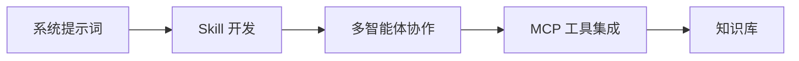

# 开发者指南

FenixAgent 开发者指南，面向使用 FenixAgent 平台构建 AI Agent 的开发者。

## 你能做什么

FenixAgent 是一个 AI Agent 控制面板，帮助你构建、配置和管理智能体。作为开发者，你可以：

- **定义 Agent 角色** — 通过系统提示词和参数配置，塑造不同职责的 Agent
- **编写 Skill** — 用 Markdown 编写技能指令，让 Agent 学会新的工作流程
- **接入外部工具** — 通过 MCP 协议连接数据库、搜索引擎、GitHub 等外部服务
- **多智能体协作** — 配置主 Agent + 子 Agent 团队，让不同角色的 Agent 协同完成复杂任务
- **构建知识库** — 为 Agent 提供 RAG 检索能力，让它基于你的私有知识回答问题

## 学习路径

1. **[系统提示词](./agent/system-prompt)** — 学会通过 prompt 和指令文件塑造 Agent 行为
2. **[Skill 开发](./agent/skill-development)** — 编写自定义 Skill，让 Agent 掌握新的工作流程
3. **[多智能体协作](./agent/multi-agent)** — 配置主 Agent 和子 Agent，让多个角色协同工作
4. **[MCP 工具集成](./agent/mcp-integration)** — 通过 MCP 协议连接外部工具和服务
5. **[知识库](./agent/knowledge-base)** — 为 Agent 构建私有知识检索能力
## 系统开发与集成

- [后端开发规范](./system/backend-development) 与[前端开发规范](./system/frontend-development)：开发和维护 FenixAgent 本身。
- [External API](./system/external-api) 与[Agent 管理与会话说明](./system/external-agent-session-guide)：将外部系统接入 FenixAgent。
